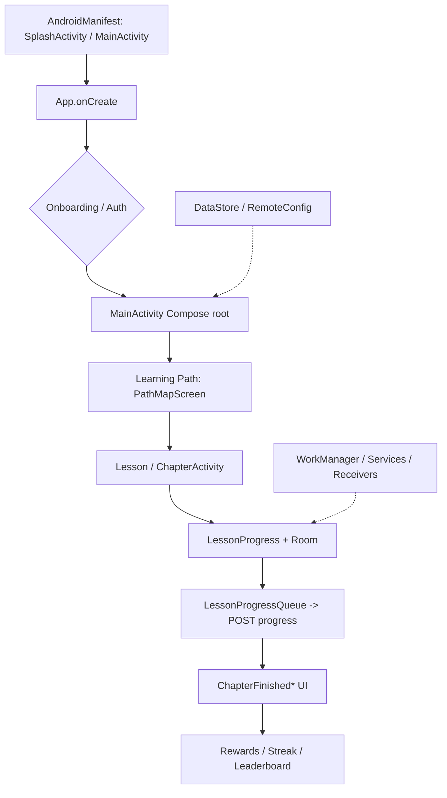

**REVIEW — گزارش فنی، بدون ادعای تأیید نهایی.** منبع حقیقت: APK اصلی Mimo 9.35
(`sha256 = 48ce1740aa4b1f892a267ae54199d514d929b97e947b612f4e53c3571e0f7c7a`). وضعیتها: `OBSERVED` | `STATICALLY INFERRED` | `RUNTIME VERIFIED` | `SERVER CONFIRMED` | `UNKNOWN`.
هیچ شبیهساز/ADB/لاگ/اسکرینشات/پاسخ سرور در این جلسه وجود ندارد؛ `RUNTIME VERIFIED` و `SERVER CONFIRMED` = **۰**.

# APPLICATION_FLOWS — جریانهای سرتاسری زیرسیستمها

## روش و هشدار

هر ردیف زیر بر **شواهد استاتیک** (`SUBSYSTEM_EVIDENCE.json`) بنا شده است. ستونها فقط جایی پر شدهاند که
مرجع واقعی وجود دارد؛ در غیر این صورت صریحاً `UNKNOWN` نوشته شده است. **هیچ جریانی RUNTIME VERIFIED نیست**.
(`OBSERVED` = رشته/کلاس/کلید SQL در APK؛ `STATICALLY INFERRED` = نقش از روی نام/مرجع؛ `UNKNOWN` = شاهد کافی نیست.)

## نمای کلی جریان اصلی (`STATICALLY INFERRED` از لبههای مشاهدهشده)

## جدول ۱۶ زیرسیستم (ده مؤلفهٔ درخواستی)

### A — راهاندازی/Init

| # | مؤلفه | یافته | وضعیت |
|---|---|---|---|
| ۱ | نقطهٔ ورود | `Lcom/getmimo/App$onCreate$1;`, `Lcom/getmimo/App$onCreate$2$1;`, `Lcom/getmimo/App;`, `Lcom/getmimo/ui/SplashActivity$checkAuthentication$1;`, `Lcom/getmimo/ui/SplashActivity$onCreate$2;` | OBSERVED (نام کلاس) / UNKNOWN (ترتیب اجرا) |
| ۲ | کلاسهای اصلی | 30 کلاس؛ لایهها: ui:15, viewmodel:10, application:3, entry_point:2 | OBSERVED |
| ۳ | مدلهای داده | ` does not have an assisted factory specified in @HiltViewModel.`, ` in both the multi-bindings of @HiltViewModelMap and @HiltViewModelAssistedMap.`, ` to be available in the multi-binding of @HiltViewModelMap but none w | OBSERVED (رشتهها) / STATICALLY INFERRED (نسبت به کلاس) |
| ۴ | متدهای اصلی | `attachBaseContext`, `create`, `invoke`, `invokeSuspend`, `onCreate`, `onResume`, `onSupportNavigateUp`, `valueOf`, `values` | OBSERVED (نام) / UNKNOWN (بدنهٔ کامل) |
| ۵ | وابستگیها | ui:15, viewmodel:10, application:3, entry_point:2 | STATICALLY INFERRED |
| ۶ | تعاملات شبکه | POST `/v1/user/visits`, GET `/v2/client-config` | STATICALLY INFERRED (مسیر) / UNKNOWN (فعل HTTP و بدنهٔ پاسخ) |
| ۷ | پایداری محلی | UNKNOWN | UNKNOWN |
| ۸ | گذار وضعیت | UNKNOWN؛ ماشین حالت coroutine: 652 کلاس | OBSERVED (دستورالعمل) / UNKNOWN (نمای کامل گذارها) |
| ۹ | خروجی UI | UNKNOWN | STATICALLY INFERRED |
| ۱۰ | وابستگی به زیرسیستمهای دیگر | POST `/v1/user/visits`, GET `/v2/client-config` | STATICALLY INFERRED |

**بخشهای ناشناخته:** ترتیب دقیق initializerها و زمانبندی DI مشاهده نشده است.

### B — احراز هویت/نشست

| # | مؤلفه | یافته | وضعیت |
|---|---|---|---|
| ۱ | نقطهٔ ورود | `Lcom/getmimo/analytics/AdjustTokenNotAvailableException;`, `Lcom/getmimo/analytics/properties/AuthenticationLocation$Activity;`, `Lcom/getmimo/analytics/properties/AuthenticationLocation$AfterPurchase;`, `Lcom/getmimo/a | OBSERVED (نام کلاس) / UNKNOWN (ترتیب اجرا) |
| ۲ | کلاسهای اصلی | 176 کلاس؛ لایهها: ui:78, repository_remote:33, analytics:23, viewmodel:18 | OBSERVED |
| ۳ | مدلهای داده | `DeviceToken` | OBSERVED (رشتهها) / STATICALLY INFERRED (نسبت به کلاس) |
| ۴ | متدهای اصلی | `component1`, `component2`, `copy`, `copy$default`, `create`, `createFromParcel`, `describeContents`, `equals`, `getDefaultViewModelProviderFactory`, `hashCode` | OBSERVED (نام) / UNKNOWN (بدنهٔ کامل) |
| ۵ | وابستگیها | ui:78, repository_remote:33, analytics:23, viewmodel:18 | STATICALLY INFERRED |
| ۶ | تعاملات شبکه | PUT `/v1/account/email`, POST `/v1/user/deviceTokens` | STATICALLY INFERRED (مسیر) / UNKNOWN (فعل HTTP و بدنهٔ پاسخ) |
| ۷ | پایداری محلی | UNKNOWN | UNKNOWN |
| ۸ | گذار وضعیت | UNKNOWN؛ ماشین حالت coroutine: 652 کلاس | OBSERVED (دستورالعمل) / UNKNOWN (نمای کامل گذارها) |
| ۹ | خروجی UI | UNKNOWN | STATICALLY INFERRED |
| ۱۰ | وابستگی به زیرسیستمهای دیگر | PUT `/v1/account/email`, POST `/v1/user/deviceTokens` | STATICALLY INFERRED |

**بخشهای ناشناخته:** جریان توکن، تازهسازی نشست و ذخیرهٔ امن آن مشاهده نشده است.

### C — Onboarding

| # | مؤلفه | یافته | وضعیت |
|---|---|---|---|
| ۱ | نقطهٔ ورود | `Lcom/getmimo/analytics/properties/AuthenticationLocation$Onboarding;`, `Lcom/getmimo/analytics/properties/OnboardingDevicePreference$Both;`, `Lcom/getmimo/analytics/properties/OnboardingDevicePreference$Desktop;`, `Lcom | OBSERVED (نام کلاس) / UNKNOWN (ترتیب اجرا) |
| ۲ | کلاسهای اصلی | 171 کلاس؛ لایهها: ui:63, analytics:62, viewmodel:24, entry_point:16 | OBSERVED |
| ۳ | مدلهای داده | `Lcom/getmimo/analytics/properties/OnboardingGoal$BetterScreenTime;`, `Lcom/getmimo/data/settings/SettingsRepository$setOnboardingSettings$2;`, `Lcom/getmimo/ui/authentication/AuthenticationScreenType$Login$Onboarding;`, | OBSERVED (رشتهها) / STATICALLY INFERRED (نسبت به کلاس) |
| ۴ | متدهای اصلی | `create`, `createFromParcel`, `describeContents`, `emit`, `equals`, `getContainer`, `getDefaultViewModelProviderFactory`, `hashCode`, `invoke`, `invokeSuspend` | OBSERVED (نام) / UNKNOWN (بدنهٔ کامل) |
| ۵ | وابستگیها | ui:63, analytics:62, viewmodel:24, entry_point:16 | STATICALLY INFERRED |
| ۶ | تعاملات شبکه | GET `/v1/user/settings`, PUT `/v1/user/settings`, POST `/v1/user/settings/avatar`, DELETE `/v1/user/settings/avatar/{uploadId}` | STATICALLY INFERRED (مسیر) / UNKNOWN (فعل HTTP و بدنهٔ پاسخ) |
| ۷ | پایداری محلی | UNKNOWN | UNKNOWN |
| ۸ | گذار وضعیت | UNKNOWN؛ ماشین حالت coroutine: 652 کلاس | OBSERVED (دستورالعمل) / UNKNOWN (نمای کامل گذارها) |
| ۹ | خروجی UI | UNKNOWN | STATICALLY INFERRED |
| ۱۰ | وابستگی به زیرسیستمهای دیگر | GET `/v1/user/settings`, PUT `/v1/user/settings`, POST `/v1/user/settings/avatar`, DELETE `/v1/user/settings/avatar/{uploadId}` | STATICALLY INFERRED |

**بخشهای ناشناخته:** شرطهای انتقال بین صفحات و ترتیب آنها نامشخص است.

### D — خانه/داشبورد

| # | مؤلفه | یافته | وضعیت |
|---|---|---|---|
| ۱ | نقطهٔ ورود | `Lcom/getmimo/analytics/properties/OnboardingGoal$DashboardsOrReports;`, `Lcom/getmimo/analytics/properties/OpenLessonSourceProperty$TrackOverview;`, `Lcom/getmimo/analytics/properties/SectionChangedSource$PathOverview;` | OBSERVED (نام کلاس) / UNKNOWN (ترتیب اجرا) |
| ۲ | کلاسهای اصلی | 51 کلاس؛ لایهها: ui:24, repository_local:15, analytics:5, viewmodel:3 | OBSERVED |
| ۳ | مدلهای داده | `InvitationsOverview` | OBSERVED (رشتهها) / STATICALLY INFERRED (نسبت به کلاس) |
| ۴ | متدهای اصلی | `component1`, `component2`, `component3`, `component4`, `component5`, `component6`, `copy`, `copy$default`, `create`, `describeContents` | OBSERVED (نام) / UNKNOWN (بدنهٔ کامل) |
| ۵ | وابستگیها | ui:24, repository_local:15, analytics:5, viewmodel:3 | STATICALLY INFERRED |
| ۶ | تعاملات شبکه | GET `/v1/leaderboards/latest`, GET `/v1/tracks/completion/lastInteracted`, GET `/v1/user/rewards/next` | STATICALLY INFERRED (مسیر) / UNKNOWN (فعل HTTP و بدنهٔ پاسخ) |
| ۷ | پایداری محلی | UNKNOWN | UNKNOWN |
| ۸ | گذار وضعیت | UNKNOWN؛ ماشین حالت coroutine: 652 کلاس | OBSERVED (دستورالعمل) / UNKNOWN (نمای کامل گذارها) |
| ۹ | خروجی UI | UNKNOWN | STATICALLY INFERRED |
| ۱۰ | وابستگی به زیرسیستمهای دیگر | GET `/v1/leaderboards/latest`, GET `/v1/tracks/completion/lastInteracted`, GET `/v1/user/rewards/next` | STATICALLY INFERRED |

**بخشهای ناشناخته:** تقریباً هیچ کلاس `home/dashboard`ای با نام صریح پیدا نشد؛ صفحهٔ اصلی احتمالاً در `MainActivity` + کامپوزابلهای `ui/*` است (INFERRED).

### E — مسیر یادگیری

| # | مؤلفه | یافته | وضعیت |
|---|---|---|---|
| ۱ | نقطهٔ ورود | `Lcom/getmimo/analytics/properties/CertificateRequestSource$PathMap;`, `Lcom/getmimo/analytics/properties/CertificateRequestSource$Profile;`, `Lcom/getmimo/analytics/properties/CertificateRequestSource;`, `Lcom/getmimo/a | OBSERVED (نام کلاس) / UNKNOWN (ترتیب اجرا) |
| ۲ | کلاسهای اصلی | 297 کلاس؛ لایهها: ui:101, model:73, usecase_interactor:55, viewmodel:38 | OBSERVED |
| ۳ | مدلهای داده | `CertificateSettings`, `Chapter`, `Chapter$$serializer`, `Chapter$Companion`, `Chapter$Creator`, `ChapterIdentifier`, `ChapterIdentifier$Creator` | OBSERVED (رشتهها) / STATICALLY INFERRED (نسبت به کلاس) |
| ۴ | متدهای اصلی | `$values`, `_childSerializers$_anonymous_`, `_childSerializers$_anonymous_$0`, `_childSerializers$_anonymous_$1`, `_init_$_anonymous_`, `_init_$lambda$0`, `annotationType`, `childSerializers`, `completionPercentage`, `co | OBSERVED (نام) / UNKNOWN (بدنهٔ کامل) |
| ۵ | وابستگیها | ui:101, model:73, usecase_interactor:55, viewmodel:38 | STATICALLY INFERRED |
| ۶ | تعاملات شبکه | GET `/v1/tracks/completion/lastInteracted`, GET `/v1/tracks/{trackId}/certificates`, GET `/v1/tracks/{trackId}/completion`, GET `/v1/tracks/{trackId}/eta`, POST `/v1/tracks/{trackId}/tutorials/{tutorialId}/chapters/{chap | STATICALLY INFERRED (مسیر) / UNKNOWN (فعل HTTP و بدنهٔ پاسخ) |
| ۷ | پایداری محلی | `CREATE TABLE IF NOT EXISTS `chapter_completions` (`chapter_id` INTEGER NOT NULL, `created_at` INTEGER NOT NULL`, `CREATE TABLE IF NOT EXISTS `lesson_progress` (`lesson_id` INTEGER NOT NULL, `completed_at` INTEGER NOT NU | OBSERVED (عبارت SQL) |
| ۸ | گذار وضعیت | `PathMapFragment$onCreate$1@50aa507c`, `create@50aa50bc`, `invoke@50aa510c`, `invokeSuspend@50aa5178`؛ ماشین حالت coroutine: 652 کلاس | OBSERVED (دستورالعمل) / UNKNOWN (نمای کامل گذارها) |
| ۹ | خروجی UI | `ObservePathSwitcherState.kt`, `ObservePathToolbarState.kt` | STATICALLY INFERRED |
| ۱۰ | وابستگی به زیرسیستمهای دیگر | GET `/v1/tracks/completion/lastInteracted`, GET `/v1/tracks/{trackId}/certificates`, GET `/v1/tracks/{trackId}/completion`, GET `/v1/tracks/{trackId}/eta`, POST `/v1/tracks/{trackId}/tutorials/{tutorialId}/chapters/{chap | STATICALLY INFERRED |

**بخشهای ناشناخته:** فرمول هندسی گرهها، dp فواصل، تابع منحنی و اسکرول بازیابی نشده است.

### F — اجرای درس

| # | مؤلفه | یافته | وضعیت |
|---|---|---|---|
| ۱ | نقطهٔ ورود | `Lcom/getmimo/analytics/properties/AiTutorInteractionSource$InteractiveLesson;`, `Lcom/getmimo/analytics/properties/LessonType$InteractiveWebView;`, `Lcom/getmimo/analytics/properties/OpenLessonTypeProperty$Quiz;`, `Lcom | OBSERVED (نام کلاس) / UNKNOWN (ترتیب اجرا) |
| ۲ | کلاسهای اصلی | 500 کلاس؛ لایهها: ui:219, viewmodel:137, model:115, analytics:10 | OBSERVED |
| ۳ | مدلهای داده | `AiTutorialConversationMessageCount`, `Attribute`, `AttributeType`, `CodeExecutionError`, `CodePlaygroundExecutionBody`, `CodePlaygroundExecutionResponse`, `CodePlaygroundTemplate` | OBSERVED (رشتهها) / STATICALLY INFERRED (نسبت به کلاس) |
| ۴ | متدهای اصلی | `$values`, `_childSerializers$_anonymous_`, `_childSerializers$_anonymous_$0`, `_childSerializers$_anonymous_$1`, `_init_$_anonymous_`, `_init_$lambda$0`, `annotationType`, `childSerializers`, `component1`, `component2` | OBSERVED (نام) / UNKNOWN (بدنهٔ کامل) |
| ۵ | وابستگیها | ui:219, viewmodel:137, model:115, analytics:10 | STATICALLY INFERRED |
| ۶ | تعاملات شبکه | GET `/v1/code`, POST `/v1/code`, POST `/v1/code/runfiles`, PUT `/v1/code/{savedCodeId}`, POST `/v1/code/{savedCodeId}/remixes`, POST `/v1/code/{savedCodeId}/runfiles`, GET `/v1/tutorials/drafts/{tutorialId}/chapters/{cha | STATICALLY INFERRED (مسیر) / UNKNOWN (فعل HTTP و بدنهٔ پاسخ) |
| ۷ | پایداری محلی | `CREATE TABLE IF NOT EXISTS `chapter_completions` (`chapter_id` INTEGER NOT NULL, `created_at` INTEGER NOT NULL`, `CREATE TABLE IF NOT EXISTS `lesson_progress` (`lesson_id` INTEGER NOT NULL, `completed_at` INTEGER NOT NU | OBSERVED (عبارت SQL) |
| ۸ | گذار وضعیت | `getTutorialId@509742cc`, `getTutorialVersion@50974308`, `CompletionRepository$attachTutorialAndChapterCompletionToTrack$1@50984214`, `invokeSuspend@50984278`؛ ماشین حالت coroutine: 652 کلاس | OBSERVED (دستورالعمل) / UNKNOWN (نمای کامل گذارها) |
| ۹ | خروجی UI | `CodePlaygroundNewCodeFileFragment.kt`, `InteractiveLessonBaseViewModel.kt` | STATICALLY INFERRED |
| ۱۰ | وابستگی به زیرسیستمهای دیگر | GET `/v1/code`, POST `/v1/code`, POST `/v1/code/runfiles`, PUT `/v1/code/{savedCodeId}`, POST `/v1/code/{savedCodeId}/remixes`, POST `/v1/code/{savedCodeId}/runfiles`, GET `/v1/tutorials/drafts/{tutorialId}/chapters/{cha | STATICALLY INFERRED |

**بخشهای ناشناخته:** منطق ارزیابی پاسخ و انواع تعاملات بهصورت جزئی بازسازی نشده است.

### G — پیشرفت درس

| # | مؤلفه | یافته | وضعیت |
|---|---|---|---|
| ۱ | نقطهٔ ورود | `Lcom/getmimo/data/model/codeeditor/autocompletion/AutoCompletionResponse;`, `Lcom/getmimo/data/model/progress/LastInteractedTrackResponse;`, `Lcom/getmimo/data/model/progress/PostProgressRequestBody;`, `Lcom/getmimo/dat | OBSERVED (نام کلاس) / UNKNOWN (ترتیب اجرا) |
| ۲ | کلاسهای اصلی | 47 کلاس؛ لایهها: repository_remote:17, repository_local:11, model:10, viewmodel:4 | OBSERVED |
| ۳ | مدلهای داده | `AutoCompletionResponse`, `LastInteractedTrackResponse`, `PostProgressRequestBody`, `PostProgressResponse`, `Progress`, `SectionEta`, `TrackCompletionResponse` | OBSERVED (رشتهها) / STATICALLY INFERRED (نسبت به کلاس) |
| ۴ | متدهای اصلی | `addOrUpdateLessonProgressInQueue`, `clear`, `clearLessonProgressQueue`, `component1`, `component10`, `component11`, `component2`, `component3`, `component4`, `component5` | OBSERVED (نام) / UNKNOWN (بدنهٔ کامل) |
| ۵ | وابستگیها | repository_remote:17, repository_local:11, model:10, viewmodel:4 | STATICALLY INFERRED |
| ۶ | تعاملات شبکه | GET `/v1/tracks/completion/lastInteracted`, GET `/v1/tracks/{trackId}/completion`, POST `/v1/tutorials/{tutorialId}/progress` | STATICALLY INFERRED (مسیر) / UNKNOWN (فعل HTTP و بدنهٔ پاسخ) |
| ۷ | پایداری محلی | `CREATE TABLE IF NOT EXISTS `chapter_completions` (`chapter_id` INTEGER NOT NULL, `created_at` INTEGER NOT NULL`, `CREATE TABLE IF NOT EXISTS `lesson_progress` (`lesson_id` INTEGER NOT NULL, `completed_at` INTEGER NOT NU | OBSERVED (عبارت SQL) |
| ۸ | گذار وضعیت | `LessonProgress@50973940`, `copy$default@509739d0`, `component1@50973b40`, `component10@50973bcc`؛ ماشین حالت coroutine: 652 کلاس | OBSERVED (دستورالعمل) / UNKNOWN (نمای کامل گذارها) |
| ۹ | خروجی UI | UNKNOWN | STATICALLY INFERRED |
| ۱۰ | وابستگی به زیرسیستمهای دیگر | GET `/v1/tracks/completion/lastInteracted`, GET `/v1/tracks/{trackId}/completion`, POST `/v1/tutorials/{tutorialId}/progress` | STATICALLY INFERRED |

**بخشهای ناشناخته:** ترتیب دقیق آفلاین→آنلاین و خطاهای همگامسازی مشاهده نشد.

### H — تمرین/چالش

| # | مؤلفه | یافته | وضعیت |
|---|---|---|---|
| ۱ | نقطهٔ ورود | `Lcom/getmimo/analytics/Analytics$LessonStreakChallenge$LessonStreakChallengeSource;`, `Lcom/getmimo/analytics/properties/AuthenticationLocation$Practice;`, `Lcom/getmimo/analytics/properties/FinishChapterSourceProperty$ | OBSERVED (نام کلاس) / UNKNOWN (ترتیب اجرا) |
| ۲ | کلاسهای اصلی | 114 کلاس؛ لایهها: ui:49, viewmodel:32, analytics:15, usecase_interactor:7 | OBSERVED |
| ۳ | مدلهای داده | `PracticeContentResponse`, `PracticeStatsResponse`, `UserTutorialStatistics` | OBSERVED (رشتهها) / STATICALLY INFERRED (نسبت به کلاس) |
| ۴ | متدهای اصلی | `component1`, `component2`, `component3`, `component4`, `copy`, `copy$default`, `create`, `createFromParcel`, `describeContents`, `equals` | OBSERVED (نام) / UNKNOWN (بدنهٔ کامل) |
| ۵ | وابستگیها | ui:49, viewmodel:32, analytics:15, usecase_interactor:7 | STATICALLY INFERRED |
| ۶ | تعاملات شبکه | GET `/v1/practice/statistics` | STATICALLY INFERRED (مسیر) / UNKNOWN (فعل HTTP و بدنهٔ پاسخ) |
| ۷ | پایداری محلی | `CREATE TABLE IF NOT EXISTS `lesson_progress` (`lesson_id` INTEGER NOT NULL, `completed_at` INTEGER NOT NULL, ``, `INSERT INTO `lesson_progress` (`lesson_id`,`completed_at`,`started_at`,`tries`,`tutorial_id`,`tutorial_ve | OBSERVED (عبارت SQL) |
| ۸ | گذار وضعیت | `isPracticeProgress@5097445c`؛ ماشین حالت coroutine: 652 کلاس | OBSERVED (دستورالعمل) / UNKNOWN (نمای کامل گذارها) |
| ۹ | خروجی UI | `GetPracticeStats.kt`, `StreakWidgetStateProvider.kt` | STATICALLY INFERRED |
| ۱۰ | وابستگی به زیرسیستمهای دیگر | GET `/v1/practice/statistics` | STATICALLY INFERRED |

**بخشهای ناشناخته:** قواعد انتخاب تمرین و چالش نامشخص است.

### I — پایان چپتر/نمره

| # | مؤلفه | یافته | وضعیت |
|---|---|---|---|
| ۱ | نقطهٔ ورود | `Lcom/getmimo/analytics/properties/AuthenticationLocation$ChapterEnd;`, `Lcom/getmimo/analytics/properties/KeysPaywallSourceProperty$ChapterEnd;`, `Lcom/getmimo/analytics/properties/PaywallTrackingSource$Keys$ChapterEnd; | OBSERVED (نام کلاس) / UNKNOWN (ترتیب اجرا) |
| ۲ | کلاسهای اصلی | 84 کلاس؛ لایهها: ui:51, viewmodel:15, usecase_interactor:13, analytics:5 | OBSERVED |
| ۳ | مدلهای داده | `, forceChapterEndProgressEtaEnabled=`, `, hasUserSeenChapterEndScreenToday=`, `, leaderboardChapterEndState=`, `BoxAnimationState(earnedCoins=`, `ChapterEndProgressWithEtaScreenData(variant=` | OBSERVED (رشتهها) / STATICALLY INFERRED (نسبت به کلاس) |
| ۴ | متدهای اصلی | `create`, `describeContents`, `equals`, `getDefaultViewModelProviderFactory`, `hashCode`, `invoke`, `invokeSuspend`, `onComplete`, `toString`, `valueOf` | OBSERVED (نام) / UNKNOWN (بدنهٔ کامل) |
| ۵ | وابستگیها | ui:51, viewmodel:15, usecase_interactor:13, analytics:5 | STATICALLY INFERRED |
| ۶ | تعاملات شبکه | GET `/v1/leaderboards/friends`, GET `/v1/leaderboards/latest`, GET `/v1/leaderboards/{leaderboardId}/userrank`, GET `/v1/user/coins`, GET `/v1/user/rewards/next`, POST `/v1/user/rewards/{rewardId}/confirm` | STATICALLY INFERRED (مسیر) / UNKNOWN (فعل HTTP و بدنهٔ پاسخ) |
| ۷ | پایداری محلی | `CREATE TABLE IF NOT EXISTS `chapter_completions` (`chapter_id` INTEGER NOT NULL, `created_at` INTEGER NOT NULL`, `CREATE TABLE IF NOT EXISTS `lesson_progress` (`lesson_id` INTEGER NOT NULL, `completed_at` INTEGER NOT NU | OBSERVED (عبارت SQL) |
| ۸ | گذار وضعیت | UNKNOWN؛ ماشین حالت coroutine: 652 کلاس | OBSERVED (دستورالعمل) / UNKNOWN (نمای کامل گذارها) |
| ۹ | خروجی UI | UNKNOWN | STATICALLY INFERRED |
| ۱۰ | وابستگی به زیرسیستمهای دیگر | GET `/v1/leaderboards/friends`, GET `/v1/leaderboards/latest`, GET `/v1/leaderboards/{leaderboardId}/userrank`, GET `/v1/user/coins`, GET `/v1/user/rewards/next`, POST `/v1/user/rewards/{rewardId}/confirm` | STATICALLY INFERRED |

**بخشهای ناشناخته:** ضرایب عددی امتیاز و ترتیب صفحههای پایان نامشخص است.

### J — پاداش/ارزها

| # | مؤلفه | یافته | وضعیت |
|---|---|---|---|
| ۱ | نقطهٔ ورود | `Lcom/getmimo/analytics/properties/OnboardingWorkFunction$ProductManagement;`, `Lcom/getmimo/analytics/properties/PurchaseProductSource$ChapterEnd;`, `Lcom/getmimo/analytics/properties/PurchaseProductSource$StoreDropdown | OBSERVED (نام کلاس) / UNKNOWN (ترتیب اجرا) |
| ۲ | کلاسهای اصلی | 173 کلاس؛ لایهها: repository_local:70, ui:22, model:21, viewmodel:20 | OBSERVED |
| ۳ | مدلهای داده | `Coins`, `Coins$Companion`, `Product`, `ProductGroup`, `ProductGroupKt`, `ProductGroupKt$WhenMappings`, `ProductType` | OBSERVED (رشتهها) / STATICALLY INFERRED (نسبت به کلاس) |
| ۴ | متدهای اصلی | `$values`, `byTypeName`, `byTypeName_delegate$lambda$0`, `component1`, `component2`, `component3`, `component4`, `component5`, `copy`, `copy$default` | OBSERVED (نام) / UNKNOWN (بدنهٔ کامل) |
| ۵ | وابستگیها | repository_local:70, ui:22, model:21, viewmodel:20 | STATICALLY INFERRED |
| ۶ | تعاملات شبکه | GET `/v1/products/user`, POST `/v1/products/user`, GET `/v1/user/activity`, GET `/v1/user/coins`, GET `/v1/user/rewards/next`, POST `/v1/user/rewards/{rewardId}/confirm` | STATICALLY INFERRED (مسیر) / UNKNOWN (فعل HTTP و بدنهٔ پاسخ) |
| ۷ | پایداری محلی | UNKNOWN | UNKNOWN |
| ۸ | گذار وضعیت | `getDailyGoalCoinReward@5096c6b8`, `DefaultCoinsRepository$getCoins$1@5098c7f4`, `create@5098c82c`, `invoke@5098c874`؛ ماشین حالت coroutine: 652 کلاس | OBSERVED (دستورالعمل) / UNKNOWN (نمای کامل گذارها) |
| ۹ | خروجی UI | `DefaultStoreRepository.kt` | STATICALLY INFERRED |
| ۱۰ | وابستگی به زیرسیستمهای دیگر | GET `/v1/products/user`, POST `/v1/products/user`, GET `/v1/user/activity`, GET `/v1/user/coins`, GET `/v1/user/rewards/next`, POST `/v1/user/rewards/{rewardId}/confirm` | STATICALLY INFERRED |

**بخشهای ناشناخته:** مقادیر پاداش و تأیید سرور فقط استنتاجشدهاند.

### K — هدف روزانه/Streak

| # | مؤلفه | یافته | وضعیت |
|---|---|---|---|
| ۱ | نقطهٔ ورود | `Lcom/getmimo/analytics/Analytics$LessonStreakChallenge$LessonStreakChallengeSource;`, `Lcom/getmimo/analytics/properties/OnboardingGoal$BuildHabit;`, `Lcom/getmimo/analytics/properties/OpenStreakDropdownSource$Path;`, ` | OBSERVED (نام کلاس) / UNKNOWN (ترتیب اجرا) |
| ۲ | کلاسهای اصلی | 139 کلاس؛ لایهها: ui:69, viewmodel:24, repository:15, usecase_interactor:15 | OBSERVED |
| ۳ | مدلهای داده | `Streak`, `UserActivityResponse` | OBSERVED (رشتهها) / STATICALLY INFERRED (نسبت به کلاس) |
| ۴ | متدهای اصلی | `component1`, `component2`, `component3`, `component4`, `copy`, `copy$default`, `create`, `describeContents`, `emit`, `equals` | OBSERVED (نام) / UNKNOWN (بدنهٔ کامل) |
| ۵ | وابستگیها | ui:69, viewmodel:24, repository:15, usecase_interactor:15 | STATICALLY INFERRED |
| ۶ | تعاملات شبکه | GET `/v1/user/activity`, GET `/v1/user/settings`, PUT `/v1/user/settings`, POST `/v1/user/settings/avatar`, DELETE `/v1/user/settings/avatar/{uploadId}` | STATICALLY INFERRED (مسیر) / UNKNOWN (فعل HTTP و بدنهٔ پاسخ) |
| ۷ | پایداری محلی | UNKNOWN | UNKNOWN |
| ۸ | گذار وضعیت | `getDailyGoalCoinReward@5096c6b8`, `SettingsRepository$getUserDailyGoal$$inlined$map$1$1@5097d39c`, `invokeSuspend@5097d3dc`, `SettingsRepository$getUserDailyGoal$2@5097d430`؛ ماشین حالت coroutine: 652 کلاس | OBSERVED (دستورالعمل) / UNKNOWN (نمای کامل گذارها) |
| ۹ | خروجی UI | `MimoStreakWidget.kt`, `ObservePathToolbarState.kt`, `SettingsRepository.kt`, `StreakBottomSheetFragment.kt`, `StreakBottomSheetViewModel.kt`, `StreakWidgetPreferences.kt` | STATICALLY INFERRED |
| ۱۰ | وابستگی به زیرسیستمهای دیگر | GET `/v1/user/activity`, GET `/v1/user/settings`, PUT `/v1/user/settings`, POST `/v1/user/settings/avatar`, DELETE `/v1/user/settings/avatar/{uploadId}` | STATICALLY INFERRED |

**بخشهای ناشناخته:** قواعد شکستن/ترمیم Streak و محاسبهٔ هدف روزانه مشاهده نشد.

### L — لیدربورد/لیگ

| # | مؤلفه | یافته | وضعیت |
|---|---|---|---|
| ۱ | نقطهٔ ورود | `Lcom/getmimo/analytics/properties/AuthenticationLocation$LeaderBoards;`, `Lcom/getmimo/analytics/properties/ViewPublicProfileSource$Leaderboard;`, `Lcom/getmimo/analytics/properties/story/OpenShareToStoriesSource$Leader | OBSERVED (نام کلاس) / UNKNOWN (ترتیب اجرا) |
| ۲ | کلاسهای اصلی | 88 کلاس؛ لایهها: ui:42, viewmodel:19, model:11, usecase_interactor:7 | OBSERVED |
| ۳ | مدلهای داده | `Leaderboard`, `LeaderboardLeague`, `LeaderboardLeague$Creator`, `LeaderboardRank`, `LeaderboardUserResult`, `ProfileLeaderboardInfo`, `RemoteLeaderboardState` | OBSERVED (رشتهها) / STATICALLY INFERRED (نسبت به کلاس) |
| ۴ | متدهای اصلی | `component1`, `component10`, `component11`, `component12`, `component2`, `component3`, `component4`, `component5`, `component6`, `component7` | OBSERVED (نام) / UNKNOWN (بدنهٔ کامل) |
| ۵ | وابستگیها | ui:42, viewmodel:19, model:11, usecase_interactor:7 | STATICALLY INFERRED |
| ۶ | تعاملات شبکه | GET `/v1/leaderboards/friends`, GET `/v1/leaderboards/latest`, GET `/v1/leaderboards/{leaderboardId}/userrank` | STATICALLY INFERRED (مسیر) / UNKNOWN (فعل HTTP و بدنهٔ پاسخ) |
| ۷ | پایداری محلی | UNKNOWN | UNKNOWN |
| ۸ | گذار وضعیت | UNKNOWN؛ ماشین حالت coroutine: 652 کلاس | OBSERVED (دستورالعمل) / UNKNOWN (نمای کامل گذارها) |
| ۹ | خروجی UI | `LeaderboardViewModel.kt`, `ObserveUserLeaderboardResult.kt` | STATICALLY INFERRED |
| ۱۰ | وابستگی به زیرسیستمهای دیگر | GET `/v1/leaderboards/friends`, GET `/v1/leaderboards/latest`, GET `/v1/leaderboards/{leaderboardId}/userrank` | STATICALLY INFERRED |

**بخشهای ناشناخته:** قواعد صعود/سقوط لیگ و بازهٔ هفتگی مشاهده نشد.

### M — AI Tutor

| # | مؤلفه | یافته | وضعیت |
|---|---|---|---|
| ۱ | نقطهٔ ورود | `Lcom/getmimo/analytics/Analytics$AiTutorInteraction$PromptType;`, `Lcom/getmimo/analytics/properties/AiTutorInteractionSource$ExecutableLesson;`, `Lcom/getmimo/analytics/properties/AiTutorInteractionSource$InteractiveLe | OBSERVED (نام کلاس) / UNKNOWN (ترتیب اجرا) |
| ۲ | کلاسهای اصلی | 82 کلاس؛ لایهها: viewmodel:31, ui:23, repository_local:15, analytics:6 | OBSERVED |
| ۳ | مدلهای داده | `AiTutorConversationMessage`, `AiTutorialConversationMessageCount`, `FinishReason`, `FollowupMessage`, `StartConversation` | OBSERVED (رشتهها) / STATICALLY INFERRED (نسبت به کلاس) |
| ۴ | متدهای اصلی | `$values`, `component1`, `component2`, `component3`, `copy`, `copy$default`, `create`, `createFromParcel`, `describeContents`, `equals` | OBSERVED (نام) / UNKNOWN (بدنهٔ کامل) |
| ۵ | وابستگیها | viewmodel:31, ui:23, repository_local:15, analytics:6 | STATICALLY INFERRED |
| ۶ | تعاملات شبکه | GET `/v1/aiTutor/conversations/messages/count` | STATICALLY INFERRED (مسیر) / UNKNOWN (فعل HTTP و بدنهٔ پاسخ) |
| ۷ | پایداری محلی | UNKNOWN | UNKNOWN |
| ۸ | گذار وضعیت | UNKNOWN؛ ماشین حالت coroutine: 652 کلاس | OBSERVED (دستورالعمل) / UNKNOWN (نمای کامل گذارها) |
| ۹ | خروجی UI | UNKNOWN | STATICALLY INFERRED |
| ۱۰ | وابستگی به زیرسیستمهای دیگر | GET `/v1/aiTutor/conversations/messages/count` | STATICALLY INFERRED |

**بخشهای ناشناخته:** پروتکل SSE، مدل پیامها و محدودیت نرخ مشاهده نشد.

### N — تنظیمات

| # | مؤلفه | یافته | وضعیت |
|---|---|---|---|
| ۱ | نقطهٔ ورود | `Lcom/getmimo/analytics/properties/AuthenticationLocation$Settings;`, `Lcom/getmimo/analytics/properties/GetHelpSource$Settings;`, `Lcom/getmimo/analytics/properties/OnboardingDevicePreference$Both;`, `Lcom/getmimo/analy | OBSERVED (نام کلاس) / UNKNOWN (ترتیب اجرا) |
| ۲ | کلاسهای اصلی | 227 کلاس؛ لایهها: repository_local:70, ui:66, repository:26, viewmodel:26 | OBSERVED |
| ۳ | مدلهای داده | `Appearance`, `AvatarUpdateResponse`, `CertificateSettings`, `ConfirmAvatarUploadBody`, `NameSettings`, `Settings`, `Settings$NotificationSettings` | OBSERVED (رشتهها) / STATICALLY INFERRED (نسبت به کلاس) |
| ۴ | متدهای اصلی | `$values`, `asSetting`, `component1`, `component2`, `component3`, `component4`, `component5`, `component6`, `component7`, `component8` | OBSERVED (نام) / UNKNOWN (بدنهٔ کامل) |
| ۵ | وابستگیها | repository_local:70, ui:66, repository:26, viewmodel:26 | STATICALLY INFERRED |
| ۶ | تعاملات شبکه | GET `/v1/user/settings`, PUT `/v1/user/settings`, POST `/v1/user/settings/avatar`, DELETE `/v1/user/settings/avatar/{uploadId}` | STATICALLY INFERRED (مسیر) / UNKNOWN (فعل HTTP و بدنهٔ پاسخ) |
| ۷ | پایداری محلی | UNKNOWN | UNKNOWN |
| ۸ | گذار وضعیت | `SettingsRepository$getUserDailyGoal$$inlined$map$1$1@5097d39c`, `invokeSuspend@5097d3dc`, `SettingsRepository$getUserDailyGoal$2@5097d430`, `invoke@5097d468`؛ ماشین حالت coroutine: 652 کلاس | OBSERVED (دستورالعمل) / UNKNOWN (نمای کامل گذارها) |
| ۹ | خروجی UI | `SettingsRepository.kt`, `StreakWidgetPreferences.kt` | STATICALLY INFERRED |
| ۱۰ | وابستگی به زیرسیستمهای دیگر | GET `/v1/user/settings`, PUT `/v1/user/settings`, POST `/v1/user/settings/avatar`, DELETE `/v1/user/settings/avatar/{uploadId}` | STATICALLY INFERRED |

**بخشهای ناشناخته:** فهرست کامل کلیدهای DataStore و مقادیر پیشفرض مشاهده نشد.

### O — پیکربندی/Feature flags

| # | مؤلفه | یافته | وضعیت |
|---|---|---|---|
| ۱ | نقطهٔ ورود | `Lcom/getmimo/analytics/FirebaseRemoteConfigFetcher$fetchAndPersistAbTestUserGroup$1;`, `Lcom/getmimo/analytics/FirebaseRemoteConfigFetcher$fetchAndPersistAbTestUserGroup$2;`, `Lcom/getmimo/analytics/abtest/ExperimentEnr | OBSERVED (نام کلاس) / UNKNOWN (ترتیب اجرا) |
| ۲ | کلاسهای اصلی | 51 کلاس؛ لایهها: model:12, data_other:10, repository:10, ui:7 | OBSERVED |
| ۳ | مدلهای داده | `ContentExperiment`, `ContentExperimentState`, `ContentExperimentState$Ended`, `ContentExperimentState$Ignore`, `ContentExperimentState$Started`, `ParsedContentExperiment`, `ParsedContentExperiment$Experiment` | OBSERVED (رشتهها) / STATICALLY INFERRED (نسبت به کلاس) |
| ۴ | متدهای اصلی | `component1`, `component10`, `component11`, `component12`, `component2`, `component3`, `component4`, `component5`, `component6`, `component7` | OBSERVED (نام) / UNKNOWN (بدنهٔ کامل) |
| ۵ | وابستگیها | model:12, data_other:10, repository:10, ui:7 | STATICALLY INFERRED |
| ۶ | تعاملات شبکه | GET `/v2/client-config` | STATICALLY INFERRED (مسیر) / UNKNOWN (فعل HTTP و بدنهٔ پاسخ) |
| ۷ | پایداری محلی | UNKNOWN | UNKNOWN |
| ۸ | گذار وضعیت | UNKNOWN؛ ماشین حالت coroutine: 652 کلاس | OBSERVED (دستورالعمل) / UNKNOWN (نمای کامل گذارها) |
| ۹ | خروجی UI | `RemoteConfigRepository.kt` | STATICALLY INFERRED |
| ۱۰ | وابستگی به زیرسیستمهای دیگر | GET `/v2/client-config` | STATICALLY INFERRED |

**بخشهای ناشناخته:** کدام فلگها فعالاند و مقادیر سرور مشاهده نشد.

### P — اشتراک/پرداخت

| # | مؤلفه | یافته | وضعیت |
|---|---|---|---|
| ۱ | نقطهٔ ورود | `Lcom/getmimo/analytics/Analytics$Core$MaxUpsellPaywallShown$Source;`, `Lcom/getmimo/analytics/Analytics$Core$PaywallShown$Source;`, `Lcom/getmimo/analytics/Analytics$ReactivationPaywallShown$Type;`, `Lcom/getmimo/analyt | OBSERVED (نام کلاس) / UNKNOWN (ترتیب اجرا) |
| ۲ | کلاسهای اصلی | 288 کلاس؛ لایهها: ui:88, viewmodel:86, repository_remote:53, analytics:44 | OBSERVED |
| ۳ | مدلهای داده | `DiscountedSubscription`, `FreeTrialSubscription`, `PurchasedProduct`, `RawPurchasedProduct`, `Subscription`, `Subscription$Creator`, `Subscription$Interval` | OBSERVED (رشتهها) / STATICALLY INFERRED (نسبت به کلاس) |
| ۴ | متدهای اصلی | `$values`, `component1`, `component2`, `component3`, `component4`, `component5`, `component6`, `component7`, `copy`, `copy$default` | OBSERVED (نام) / UNKNOWN (بدنهٔ کامل) |
| ۵ | وابستگیها | ui:88, viewmodel:86, repository_remote:53, analytics:44 | STATICALLY INFERRED |
| ۶ | تعاملات شبکه | GET `/v1/products/user`, POST `/v1/products/user` | STATICALLY INFERRED (مسیر) / UNKNOWN (فعل HTTP و بدنهٔ پاسخ) |
| ۷ | پایداری محلی | UNKNOWN | UNKNOWN |
| ۸ | گذار وضعیت | UNKNOWN؛ ماشین حالت coroutine: 652 کلاس | OBSERVED (دستورالعمل) / UNKNOWN (نمای کامل گذارها) |
| ۹ | خروجی UI | `PaywallViewModel.kt` | STATICALLY INFERRED |
| ۱۰ | وابستگی به زیرسیستمهای دیگر | GET `/v1/products/user`, POST `/v1/products/user` | STATICALLY INFERRED |

**بخشهای ناشناخته:** جریان خرید/ entitlement فقط از نام کلاسها استنتاج میشود؛ هیچ تراکنش مشاهدهای ثبت نشد.

## آنچه در هیچ زیرسیستمی RUNTIME VERIFIED نشده است

- ترتیب واقعی فراخوانیها، زمانبندی coroutineها و خطاهای شبکه.
- مقادیر واقعی پاسخ سرور و تغییر حالت پس از آن (`SERVER CONFIRMED` = ۰).
- ناوبری واقعی بین صفحات، انیمیشنها و اسکرول (هیچ ADB UI hierarchy / logcat / screenshot تولید نشد).
- نقشهٔ کامل routeهای `NavHost`؛ فقط ۹ deep-link filter و ۳۰۰ رشتهٔ routeمانند یافت شد (`COMPONENT_GRAPH.json`).

## شناسههای شاهد

- EV-0033, EV-0034, EV-0035, EV-0036, EV-0037, EV-0038
- EV-0233, EV-0234, EV-0235, EV-0236, EV-0237, EV-0238
- EV-0193, EV-0194, EV-0195, EV-0196, EV-0197, EV-0198
- EV-0296

---

## الحاق MISSION 02 — تصحیح و اتصال (بدون بازنویسی متن بالا)

> محتوای بالا **حفظ شد**؛ یافتههای جدید فقط به آن متصل میشوند.

- **افعال HTTP دیگر `LOW`/استنتاج از نام متد نیستند.** با دیکود `classes3.dex`
  `Lge0/r0;->a @0xabb18` (Retrofit `RequestFactory$Builder` R8شده) نگاشت
  `Lie0/f;→GET`, `Lie0/o;→POST`, `Lie0/n;→PATCH`, `Lie0/p;→PUT`,
  `Lie0/b;→DELETE`, `Lie0/m;→OPTIONS`, `Lie0/g;→HEAD` **از بایتکد** استخراج شد
  و ورودیهای `ie0.*` در ۵۳ فایل JADX تأیید شد (`HTTP_VERBS_RESOLVED.json`).
  **۶ برچسب قدیمی تصحیح شد**: `@n` در واقع `PATCH` (۳ نقطه)، `@p` در واقع `PUT` (۲)،
  `@b` در واقع `DELETE` (۱). شمارش صحیح: GET ۲۶ · POST ۲۱ · PATCH ۳ · PUT ۲ · DELETE ۱.
  همچنان **`SERVER CONFIRMED` = ۰** (هیچ پاسخی ثبت نشد).
- **گراف ارتباطات به سطح متد ارتقا یافت**: ۶٬۰۱۶ جفتفراخوانی درون `com/getmimo`
  با `DEX` + `insn_offset` + امضای کامل (`COMPLETE_COMPONENT_GRAPH.json`).
  لبههای `ui→viewmodel→usecase→repository` اکنون علاوه بر ارجاع نوعی، **دستورالعمل `invoke`** دارند؛
  با این حال الگو سراسری نیست.
- **زنجیرهٔ درس اثبات شد**: `isSolvedCorrectly @0xa56474` → `storeLessonProgress @0xa563da` →
  `addOrUpdateLessonProgressInQueue @0x997ddc` → `postProgress @0x998976` →
  `toLessonProgressSyncResult @0x998992` → صفحهٔ پایان چپتر `@0x9a282a` →
  `GetPathMapState$invoke$3` `@0x9a9240…0x9a9444`. جزئیات در `COMPLETE_APPLICATION_FLOW.fa.md`.
- **وضعیت runtime تغییر نکرد**: ممیزی MISSION 02 نشان داد emulator/ADB/KVM/SDK/حساب مجاز
  وجود ندارد؛ ۰/۹ آزمایش اجرا شد. ضمیمه در `RUNTIME_VERIFICATION.fa.md`.
- شکافها و پوشش بهروزشده: `FINAL_KNOWN_GAPS.fa.md`؛ شاهدها: `EV-M02-0001…0027` در `EVIDENCE_INDEX.json`.
