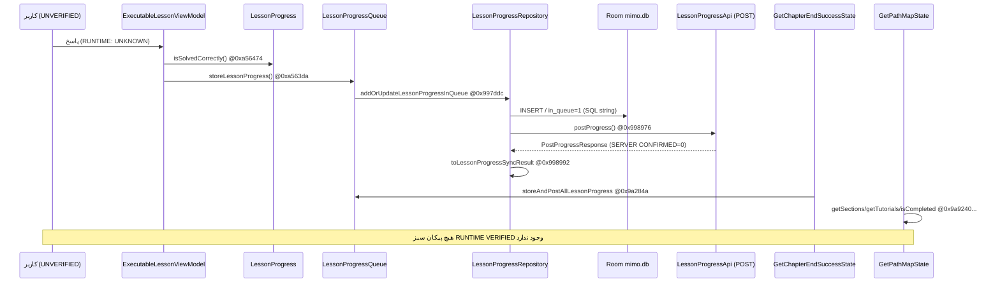

**REVIEW — MISSION 02.** این سند مسیر کامل عملیات کاربر را **از شواهد بایتکد** بازسازی میکند،
نه از حدس معماری و نه از مشاهدهٔ اجرا. `RUNTIME VERIFIED` = ۰، `SERVER CONFIRMED` = ۰.
منبع: APK `48ce1740…f7c7a`، عمدتاً `classes.dex` (و `classes3.dex` برای Retrofit).
شواهد دقیق: `DEX_BYTECODE_EVIDENCE.json` / `COMPLETE_COMPONENT_GRAPH.json` / `EVIDENCE_INDEX.json` (ردیفهای `EV-M02-*`).

---

# COMPLETE_APPLICATION_FLOW — مسیر کامل و اثباتشده

## ۰. تفاوت این سند با مرحلهٔ قبل

مرحلهٔ ۱ **کلاسها** را کاتالوگ کرد. این مرحله **دستورالعمل `invoke-*`** را دیکود کرد:
هر لبه زیر شامل `caller`, `callee`, `DEX`, `insn_offset`, `opcode` است و قابل بازتولید است
(`dex_bytecode.decode_reachable`). خطاهای رایج حذف شدند: payloadـهای `packed-switch`/
`fill-array-data`، بایتهای junk ابزار Smob بعد از `return`، و `invoke-custom` (که `call_site_idx`
دارد نه `method_idx`). نتیجه: ۱۲۲٬۵۴۶/۱۲۲٬۵۴۶ متد، ۵۵۲٬۶۲۵ فراخوانی، ۶٬۰۱۶ جفتفراخوانی درون `com/getmimo`.

## ۱. سناریوی معیار کاربر (۷ گام) — وضعیت اثبات

| # | آنچه باید اثبات شود | کد مسئول (`classes.dex`) | آفست | وضعیت |
|---|---|---|---|---|
| ۱ | تشخیص پاسخ صحیح | `ExecutableLessonViewModel$doOnLessonCorrectlySolved$2::invokeSuspend` → `LessonProgress::isSolvedCorrectly()` | `0xa56474` | `OBSERVED` |
| ۱ب | شرط «درست» | `LessonProgress::isSolvedCorrectly`: `iget [0x472e]` + `if_lt v1,1` ⇒ **`intField >= 1`** | Ghidra `0x509744bc` | `OBSERVED/HIGH` |
| ۲ | تغییروضعیت پیشرفت | `doOnLessonCorrectlySolved$2` → `LessonProgressQueue::storeLessonProgress(...)` | `0xa563da` | `OBSERVED` |
| ۲ب | ذخیرهٔ محلی + شمارش | `storeLessonProgress` → `LessonProgressRepository::addOrUpdateLessonProgressInQueue` / `updateCorrectAnswersCount` / `LessonProgress::getAttempts()` / `updateLessonStreakDetector` | `0x997ddc`, `0x997e08`, `0x997e22`, `0x997e32` | `OBSERVED` |
| ۳ | ثبت محلی و ارسال به سرور | `LessonProgressRepository$postUnsyncedLessonProgress$2::invokeSuspend` → DAO (`0x99881a`), `LessonProgressApi::postProgress(J, PostProgressRequest, Continuation)` (`0x998976`), `toLessonProgressSyncResult` (`0x998992`), DAO مجدد (`0x998a08`) | `0x99881a…0x998a08` | `OBSERVED` |
| ۳ب | فعل HTTP | `POST /v1/tutorials/{tutorialId}/progress` — **حلشده از بایتکد**، نه نام متد | `classes3.dex @0xabbf0` | `OBSERVED` / نه `SERVER CONFIRMED` |
| ۳ج | SQL مشاهدهشده | `INSERT INTO lesson_progress (...) VALUES (?,…)` · `SELECT * FROM lesson_progress WHERE in_queue = 1` · `DELETE FROM lesson_progress WHERE in_queue = 1` | رشتههای DEX | `OBSERVED` |
| ۴ | نگاشت پاسخ سرور | `LessonProgressRepository::toLessonProgressSyncResult` → `PostProgressResponse::getReachedGoal()` / `getDailyGoalCoinReward()` | `0x998cf4`, `0x998cfe` | `OBSERVED` |
| ۵ | نمایش پاداش | `GetChapterEndSuccessState$storeAndPostAllLessonProgress$lessonProgressSyncResult$1::invokeSuspend` → interactor چپتر (`0x9a282a`) و `LessonProgressQueue::storeAndPostAllLessonProgress` (`0x9a284a`); `storeAndPostAllLessonProgress$1` → `d::c(ChapterBundle,…)` (`0x9a2660`) | `0x9a2660…0x9a284a` | `OBSERVED` |
| ۵ب | تأیید Reward | `DefaultRewardRepository$sendConfirmationRequestToBackend$2`, `MainViewModel$confirmRewardAndLookForNewRewards$1`، `POST /v1/user/rewards/{rewardId}/confirm` | `0x99b564`, `0xa8ddc8` | `OBSERVED` (کد) / `INFERRED` (ترتیب) |
| ۶ | بهروزرسانیوضعیت مسیر | `GetPathMapState$invoke$2::invokeSuspend` → `CompletionRepository::a(Track,…)` (`0x9a8f9c`); `invoke$3` → `getSections()` `0x9a9240`, `getTutorials()` `0x9a927e`, `getType()` `0x9a92f4`, `isRequired()` `0x9a93e6`, **`isCompleted()` `0x9a940c`**, `getIconBanner()` `0x9a9434`, `getTitle()` `0x9a943c`, `getChapters()` `0x9a9444` | `0x9a8f9c…0x9a9444` | `OBSERVED` |
| ۷ | قاعدهدسترسی گره بعدی | **هیچ بدنهٔ متدی نگاشت «completed/required/type/section → locked/available/completed» را بازسازی نکرد** | — | **`UNKNOWN`** |

> **جمع:** ۶/۷ گام دارای شاهد بایتکد با آدرس دقیقاند؛ **۰/۷ گام `RUNTIME VERIFIED` است**.
> گام ۷ و تمام «آنچه کاربر میبیند» بدون شبیهساز `UNKNOWN` باقی میماند.

## ۲. مسیر ۱۱مرحلهای درخواستی (مادهٔ ۲)

ستونها: **دیدن کاربر** / **Component** / **ViewModel** / **متد** / **داده** / **DB** / **سرور** / **بازگشت به صفحه**.

| مرحله | مشاهدهٔ کاربر | Component + ViewModel | متد (آفست) | داده / DB / سرور | بازگشت |
|---|---|---|---|---|---|
| Application Launch | `UNKNOWN` | `com.getmimo.App`؛ `SplashActivity$checkAuthentication$1` | `App.onCreate` (نام `OBSERVED`، بدنه `UNKNOWN`) | `androidx.startup.InitializationProvider`, `FirebaseInitProvider` در Manifest | `UNKNOWN` |
| Home Screen | `UNKNOWN` | `MainActivity`؛ `MainViewModel` (`ui/main/d`) | `MainViewModel$confirmRewardAndLookForNewRewards$1` @`0xa8ddc8` | `GET /v1/user/rewards/next`؛ `DefaultRewardRepository` | `UNKNOWN` |
| Learning Path | `UNKNOWN` | `PathMapFragment` / `PathMapScreenKt`؛ `PathMapViewModel` (`ui/path/map/j`) | `PathMapViewModel$init$2::invokeSuspend` @`0xaa8aba`؛ `$fetchTrackEta$1` @`0xaa837a` | `GET /v1/tracks/{trackId}/eta`؛ `CompletionRepository` | `UNKNOWN` |
| Select Tutorial | `UNKNOWN` | `PathMapViewModel$onTutorialClick$1` | `navigateToChapter` (نام کلاس لامبدا `OBSERVED`) | `ChapterBundle` | `UNKNOWN` |
| Lesson Execution | `UNKNOWN` | `ChapterActivity`؛ `ExecutableLessonViewModel`؛ `LessonBaseViewModel$storeLessonProgressInMemory$2` | @`0xa6ee8a`؛ `initialise$1$2` @`0xa583d2` | `LessonBundle` | `UNKNOWN` |
| Answer Evaluation | `UNKNOWN` | `ExecutableLessonViewModel$doOnLessonCorrectlySolved$2` | `isSolvedCorrectly` @`0xa56474` | `intField >= 1` | **بله (اثباتشده)** |
| Lesson Completion | `UNKNOWN` | `LessonProgressQueue` | `storeLessonProgress` @`0xa563da` → `addOrUpdateLessonProgressInQueue` @`0x997ddc` | `INSERT lesson_progress`, `in_queue=1` | **بله (اثباتشده)** |
| Score / Reward | `UNKNOWN` | `GetChapterEndSuccessState`؛ `ChapterFinishedViewModel`؛ `DefaultRewardRepository` | @`0x9a282a`, @`0x9a284a`, @`0x99b564` | `getReachedGoal`, `getDailyGoalCoinReward`، `POST …/confirm` | **بله (اثباتشده)** |
| Progress Persistence | `UNKNOWN` | `LessonProgressRepository$postUnsyncedLessonProgress$2` | @`0x99881a`…`0x998a08` | Room + `POST …/progress` | **بله (اثباتشده)** |
| Return to Learning Path | `UNKNOWN` | `GetPathMapState$invoke$2/$invoke$3` | @`0x9a8f9c`…`0x9a9444` | `chapter_completions`, `tutorial_completions`, `Track.tutorials` | **بله (اثباتشده)** |
| Next Node State | `UNKNOWN` | — | — | — | **`UNKNOWN`** |

## ۳. پاسخ صریح به معیار ارزیابی کاربر

> «تفاوت بین داشتن نقشهای از کدها و واقعاً فهمیدن نحوهٔ کار Mimo»

آنچه **اکنون اثباتشده** است: زنجیرهٔ علّی `پاسخ → شرط → صف → Room → API → پاسخ → صفحهٔ پایان → حلقهٔوضعیت مسیر`
با ۲۶ لبهٔ `invoke` مشخص و آفست بایتکد. این یک **گراف فراخوانی واقعی** است، نه تطابق نام کلاسها.
آنچه **هنوز اثباتنشده** است: اینکه این زنجیره در اجرا بههمین ترتیب طی شود، اینکه پاسخ سرور چه
مقادیری داشته باشد، اینکه کاربر چه ببیند، و قاعدهٔ باز شدن گره بعدی. دلیل دقیق: نبود
emulator/ADB (ممیزی در `RUNTIME_VERIFICATION.fa.md`)، بنابراین **ادعای «واقعاً فهمیدیم» نمیشود**؛
ادعای معتبر «زنجیرهٔ کد را با شاهد بایتکد اثبات کردیم، رفتار اجرایی را نه» است.

## ۴. برچسبها و شناسهها

`OBSERVED` = دستورالعمل/رشته/امضای DEX · `STATICALLY INFERRED` = نقش و ترتیب ·
`RUNTIME VERIFIED` = ۰ · `SERVER CONFIRMED` = ۰ · `UNKNOWN` = گام ۷ + تمام UI/مقادیر.
شاهدها: `EV-M02-0006` (دیکود)، `EV-M02-0007` (گراف)، `EV-M02-0008..09` (افعال)،
`EV-M02-0010..0013` (زنجیره)، `EV-M02-0016` (قاعدهٔ قفل `UNKNOWN`)، `EV-M02-0019..0027` (TEST-ها).
EOF