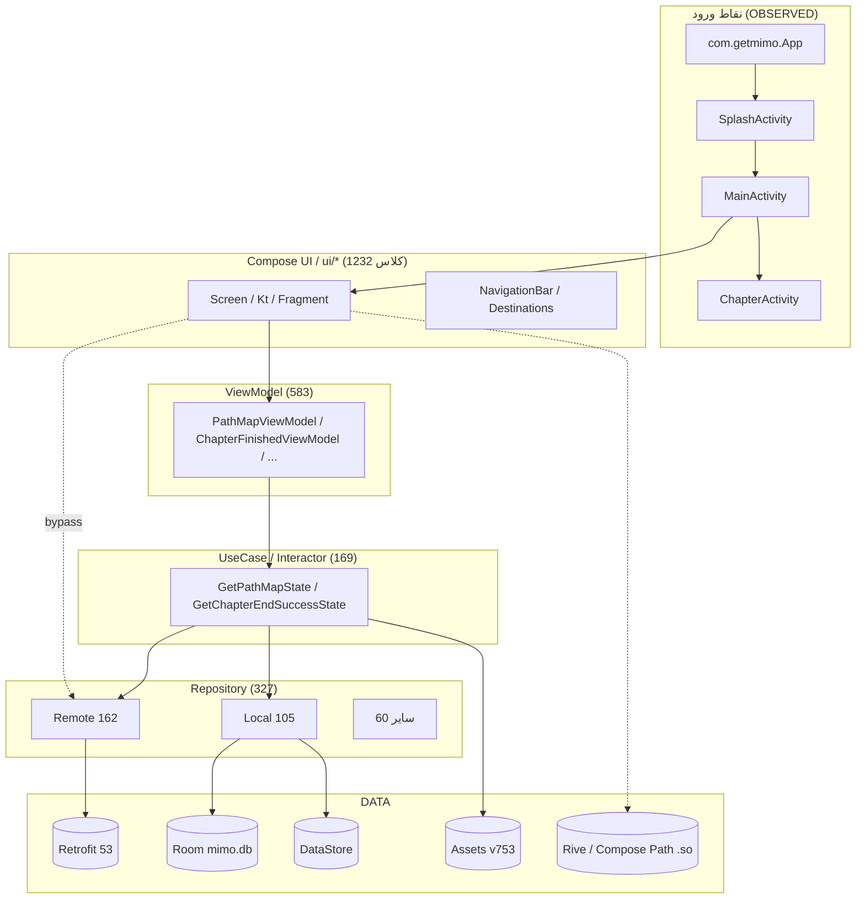

**REVIEW — سند معماری، بدون ادعای تأیید نهایی و بدون ادعای بازیابی کامل سورس.**
منبع حقیقت: APK اصلی Mimo 9.35، `sha256=48ce1740aa4b1f892a267ae54199d514d929b97e947b612f4e53c3571e0f7c7a`.
برچسبها: `OBSERVED` | `STATICALLY INFERRED` | `RUNTIME VERIFIED` | `SERVER CONFIRMED` | `UNKNOWN`.
`RUNTIME VERIFIED` و `SERVER CONFIRMED` در این جلسه **۰** هستند (نه شبیهساز/ADB تأییدشده، نه محیط تست مجاز).

---

# COMPLETE_SYSTEM_ARCHITECTURE — معماری و روابط

## ۰. خلاصهٔ اجرایی (چهارگانه)

| دسته | محتوا |
|---|---|
| **WHAT WE KNOW** (`OBSERVED`) | بایتهای APK، هدر و جداول ۱۲ DEX، ۱۲۲٬۵۴۶ `code_item`، Manifest باینری، `resources.arsc`، ۱۲ کتابخانهٔ بومی، assetها، ۶۸ عبارت SQL، ۵۳ تعریف Retrofit، ۳٬۱۳۳ توصیفگر `com.getmimo`، ۱۲۲ بدنهٔ دستورالعملی Ghidra |
| **WHAT WE INFER** (`STATICALLY INFERRED`) | لایهبندی مؤلفهها، گراف وابستگی نوعی، افعال HTTP، مالکیت برخیوضعیتها، نقش کامپوزابلها |
| **WHAT WE VERIFIED AT RUNTIME** | **هیچچیز.** ۰ اسکرینشات، ۰ UI hierarchy، ۰ logcat، ۰ پاسخ سرور |
| **WHAT WE STILL DO NOT KNOW** | هندسهٔ گرهها، ضرایب امتیاز، ترکیب نمادهای Ghidra، نگاشت کامل R8، نقشهٔ routeها، نشست/توکن، رفتار آفلاین→آنلاین، کلیهٔ رفتارهای اجرایی |

## ۱. زمینهٔ تأییدشده و reconcile مستقل

| کمیت | مقدار | روش / وضعیت |
|---|---|---|
| اعضای ZIP | ۱۴٬۳۹۸ | `zipfile`، `OBSERVED` |
| DEX | ۱۲ فایل / ۲۸٬۸۳۶٬۰۸۸ بایت | `OBSERVED`؛ کپیهای `ANALYSIS/_INPUT/` بایتبهبایت با اعضای APK یکساناند |
| صحت DEX | ۱۲/۱۲ Adler32 ✅، ۱۲/۱۲ SHA-1 امضا ✅، ۰ خطای parse | `dexlib.py`، `OBSERVED/HIGH` |
| class_def | ۲۹٬۴۵۴ | `OBSERVED` |
| متد تعریفشده | ۱۲۹٬۰۷۱ | `class_data_item`؛ برابر با شمارش ۱۲۹٬۰۷۱ متد JADX MCP (cross-check) |
| متد دارای بدنه | ۱۲۲٬۵۴۶ | `code_item` = `defined_methods_with_code` = **تابع Ghidra**، تکتک ۱۲ DEX ✅ |
| متد بدون بدنه | ۶٬۵۲۵ | `code_off=0` → abstract/interface/native؛ **«عملکرد گمشده» نیست** (قید ۷) |
| string/type/proto/field/method id | ۱۲۱٬۲۵۲ / ۴۰٬۰۶۹ / ۳۷٬۷۹۹ / ۸۹٬۶۰۰ / ۱۴۹٬۵۶۷ | `OBSERVED` |
| نماد Ghidra | ۱٬۲۸۴٬۵۴۲ | جمع حسابی ۱۲ سربرگ ✅؛ **ترکیب UNKNOWN** |

> **باز reconcile عدد ۱۲۲٬۵۴۶:** پارسر مستقل `dexlib.py` تعداد `code_item` را از `map_list` هر DEX خواند:
> ۵۴٬۵۳۰ + ۵۳٬۲۴۷ + ۱۴٬۷۰۴ + ۴۱ + (۸×۳) = **۱۲۲٬۵۴۶**؛ Ghidra با Auto Analysis دقیقاً همان اعداد را بهصورت تابع گزارش کرد.
> **عدد ۱٬۲۸۴٬۵۴۲:** ۶۸۱٬۹۷۶ + ۴۶۳٬۵۰۰ + ۱۳۶٬۹۷۷ + ۱٬۵۳۷ + (۸×۶۹) = ۱٬۲۸۴٬۵۴۲ ✅، ولی
>پایه ساختاری DEX تنها ۵۹۰٬۲۸۷ آیتم است و ۶۹۴٬۲۵۵ برچسب باقیمانده توسط Ghidra
> (`string_data::`، `EXTERNAL.dex-N::`، برچسبهای کلاس/متد/داده) ساخته میشود. فرمول دقیق آن
> از سرآیند DEX قابل استخراج نیست → `UNKNOWN`. منبع: `APK_COMPLETE_INVENTORY.json`.

`method_ids_size` در `classes.dex` و `classes2.dex` هر دو دقیقاً **۶۵٬۵۳۶ = ۲^۱۶** است (سقف مرجع متد DEX)؛
این `OBSERVED` است و دلیل ساختاری تقسیم اپ به ۱۲ DEX را توضیح میدهد.

## ۲. نقاط ورود و لایهٔ Application

`AndroidManifest.xml` باینری (با `AXMLPrinter` همان androguard نصبشده، بدون ابزار تازه):

| نقش | کلاس | وضعیت |
|---|---|---|
| Application | `com.getmimo.App` | `OBSERVED` |
| Launcher / Splash | `com.getmimo.ui.SplashActivity` (exported=true، ۳ intent-filter) | `OBSERVED` |
| ریشهٔ اصلی | `com.getmimo.ui.main.MainActivity` (exported=true، ۳ intent-filter) | `OBSERVED` |
| صفحهٔ چپتر/درس | `com.getmimo.ui.chapter.ChapterActivity` | `OBSERVED` |
| سایر | `OnboardingActivity`, `AuthenticationActivity`, `SettingsActivity`, `SetDailyGoalActivity`, `AllPlansActivity`, `IntroSlidesActivity`, `LearningCompanionsIntroActivity` | `OBSERVED` |
| اجزا | ۶۱ activity + ۶ alias + ۱۹ service + ۲۰ receiver + ۸ provider + ۲۴ permission + ۵۱ meta-data | `OBSERVED` |
| Deep link | ۹ فیلتر با schemeهای `https` و `mimo` روی `SplashActivity`/`MainActivity` | `OBSERVED` |

`androidx.startup.InitializationProvider`، `FirebaseInitProvider`، `MobileAdsInitProvider` و
`ComponentDiscoveryService` در Manifest حضور دارند → راهاندازی مبتنی بر App Startup / Firebase ComponentDiscovery
`OBSERVED` است، ولی **ترتیب دقیق initializerها `UNKNOWN`** است.

## ۳. مدل لایهای (توزیع نامها، نه ادعای معماری سراسری)

**لبههای مشاهدهشده (`COMPONENT_GRAPH.json`، ارجاع نوعی از DEX + لبههای Smali):**

| لبه | تعداد مرجع نوعی | لبهٔ Smali `invoke` | وضعیت |
|---|---|---|---|
| `ui → viewmodel` | ۱۸ (۱۲ امضا + ۶ فیلد) | ۴ | `OBSERVED` |
| `viewmodel → usecase_interactor` | ۳۴ (۱۸ + ۱۶) | ۲ | `OBSERVED` |
| `usecase_interactor → repository_remote` | ۵۱ (۲۵ + ۲۶) | ۰ | `OBSERVED` |
| `usecase_interactor → repository_local` | ۲۸ (۱۴ + ۱۴) | ۰ | `OBSERVED` |
| `repository → model` | ۳۴ (۱۶ + ۱۸) | — | `OBSERVED` |
| `ui → repository_remote` (bypass) | ۸۹ (۴۸ + ۴۱) | ۱ | `OBSERVED` |

بنابراین زنجیرهٔ `SCREEN → VIEWMODEL → USECASE → REPOSITORY → API/DB` ** در بخشی از گراف وجود دارد**
اما **سراسری نیست**: ۸۹ مرجع نوعی `ui → repository_remote` و ۵۳ مرجع `ui → usecase` نشان میدهد مسیرهای
میانبر/تزریق مستقیم هم هست. تعداد لبههای Smali بسیار کمتر است، چون Smali عمدتاً روی `classes2/3`
(کتابخانهها) موفق بود و `classes.dex` (جایی که ۳٬۰۳۲ کلاس `com.getmimo` قرار دارد) ۱۱٬۸۲۸ شکست خورد.
**تفسیر «کمبود لبه» بهمعنی «کمبود رابطه» نیست.**

## ۴. گراف فراخوانی با ارجاع به DEX و آدرس

نمونه گرههای مهم (همه `classes.dex`، زبان `Dalvik:LE:32:DEX_KitKat`، Ghidra 12.2 Auto Analysis):

| گره | کلاس / متد | آدرس | شاهد |
|---|---|---|---|
| مسیر یادگیری | `com::getmimo::interactors::path::GetPathMapState$invoke$2::invokeSuspend` | `0x509a8f34` | ۳۸ دستورالعمل، `if_eqz`/`invoke_virtual`/`move_result_object` |
| مسیر یادگیری | `GetPathMapState$invoke$3::invokeSuspend` | `0x509a90c8` | ۷۱ دستورالعمل (۲٬۳۸۶ بایت بدنه) |
| مسیر یادگیری | `GetPathMapDialogs$invoke$2::invokeSuspend` | `0x509a8900` | ۷۱ دستورالعمل (۹۵۴ بایت) |
| مسیر یادگیری | `PathMapFragment$onCreate$1::invokeSuspend` | `0x50aa5178` | ۱۶۶ بایت بدنه |
| مسیر یادگیری | `PathMapScreenKt$PathMapScreen$10$1$job$1::invokeSuspend` | `0x50aa64b8` | ۳۵ دستورالعمل، شامل `invoke_static`/`invoke_direct_range` |
| پیشرفت | `com::getmimo::data::model::room::LessonProgress::LessonProgress` | `0x50973940` | ۱۵ دستورالعمل `iput` روی ۱۱ فیلد |
| پیشرفت | `LessonProgress::isSolvedCorrectly` | `0x509744bc` | `iget` + `if_lt v1,1` → شرط `>= 1` |
| اتمام | `CompletionRepository$getChapterCompletionCount$1::invokeSuspend` | `0x50984644` | ۱۹ دستورالعمل |
| پاداش | `PostProgressResponse::getDailyGoalCoinReward` | `0x5096c6b8` | `iget` + `return` |

فهرست کامل ۱۲۲ تابع هدف در `GHIDRA/CONTROL_FLOW.txt` و `GHIDRA/TARGET_FUNCTIONS.json`؛
شناسهها در `EVIDENCE_INDEX.json`.

## ۵. لایههای عرضی

| لایه | شاهد | وضعیت |
|---|---|---|
| Compose | `META-INF/androidx.compose.*.version` = ۱.۱۲.۱، material3 ۱.۴.۰؛ `PathMapFragment` بدون XML نقشه | `OBSERVED` |
| بومی | ۱۲ فایل `.so` در `arm64-v8a`/`armeabi-v7a`: `libandroidx.graphics.path.so`, `librive-android.so`, `libdatastore_shared_counter.so`, `libsigner.so`, `libyrf.so`, `libc++_shared.so` | `OBSERVED`؛ نقش دقیق `INFERRED` |
| تزریق وابستگی | رشتههای `@HiltViewModelMap` / `@HiltViewModelAssistedMap`، کلاسهای `_Factory`، `@Provides`-مانند | `OBSERVED` (رشته) / `INFERRED` (Hilt/Dagger) |
| پسزمینه | `androidx.work` (جداول `WorkSpec`, `WorkProgress`)، ۵ کلاس `*Worker` شامل `StreakWidgetRefreshWorker`، `UpdateNotificationsSettingsWork` | `OBSERVED` |
| Coroutine | ۵۳۹ `DebugMetadata` (`Lf70/c;`، فقط `c/f/l/m/v`)، ۸۴ فیلد `label/L$/I$/J$`، ۶۵۲ کلاس suspend | `OBSERVED`؛ جدول `n/i/s` توسط R8 حذف شده |
| تحلیل/ردیابی | ۳۲۶ کلاس `analytics/properties` | `OBSERVED` |
| شبکه | ۵۳ تعریف Retrofit با اعلانهای R8شده؛ `@k`=headers، `@s/@t`=path/query، `@a`=body | `OBSERVED` (رشته) / `INFERRED` (فعل) |
| دادهٔ محتوا | `assets/lessons-en/tracks/tracks.json` v753؛ ۱۰٬۳۱۷ JSON، ۱۱ بستهٔ زبانی محتوا | `OBSERVED` |

## ۶. محدودیتهای ساختاری که معماری را محدود میکنند

1. **R8**: `source_file_idx` روی ۲۵٬۸۶۷ class_def برابر `r8-map-id-6b1b9a7a…` است و **فایل mapping در APK نیست**.
   تنها ۴۹۱ نگاشت کلاس کوتاه→نام منطقی از `DebugMetadata.c` بهدست آمد. دیابسکیشن کامل `UNKNOWN`.
2. **بدنهٔ متدها**: JADX ۱.۵.۶ روی `classes.dex` → ۲٬۲۱۱ فایل Java، ۲٬۱۷۹ فایل حاوی stub (۹۸٫۵۵٪)،
   ۲۴۳٬۰۰۲ خطا. Ghidra در عوض **همهٔ ۱۲۲٬۵۴۶ متد بدهدار** را تابع/دستورالعمل داد؛ ولی
   **disassembly سطح پایین ≠ بازسازی معنای سطح بالا** است.
3. **xref رشته→تابع = ۰** (آنالایزر `Reference` در PSPEC لودر DEX غیرفعال). نام فیلدها معتبرند،
   ولی نسبت قطعی به کلاس صاحبشان باز است.
4. **هیچ اجرای زندهای** برای تأیید ناوبری، اسکرول، امتیاز، پاداش یا پاسخ سرور انجام نشده است.

## ۷. پروندههای پیوسته

`COMPONENT_CATALOG.fa.md` · `APPLICATION_FLOWS.fa.md` · `DATA_AND_API_MAP.fa.md` ·
`LEARNING_PATH_ENGINE.fa.md` · `LESSON_AND_SCORING_ENGINE.fa.md` · `RUNTIME_VERIFICATION.fa.md` ·
`COVERAGE_REPORT.fa.md` · `EVIDENCE_INDEX.json` · `APK_COMPLETE_INVENTORY.json` ·
`COMPONENT_GRAPH.json` · `SUBSYSTEM_EVIDENCE.json` · `COVERAGE_METRICS.json`.

> نتیجهگیری: یک **مدل معماری متصل و شاهددار** ساخته شد، ولی «بازیابی کامل سورس/رفتار» محقق نشده و ادعا نمیشود.

---

## الحاق MISSION 02 — تصحیح و اتصال (بدون بازنویسی متن بالا)

> محتوای بالا **حفظ شد**؛ یافتههای جدید فقط به آن متصل میشوند.

- **افعال HTTP دیگر `LOW`/استنتاج از نام متد نیستند.** با دیکود `classes3.dex`
  `Lge0/r0;->a @0xabb18` (Retrofit `RequestFactory$Builder` R8شده) نگاشت
  `Lie0/f;→GET`, `Lie0/o;→POST`, `Lie0/n;→PATCH`, `Lie0/p;→PUT`,
  `Lie0/b;→DELETE`, `Lie0/m;→OPTIONS`, `Lie0/g;→HEAD` **از بایتکد** استخراج شد
  و ورودیهای `ie0.*` در ۵۳ فایل JADX تأیید شد (`HTTP_VERBS_RESOLVED.json`).
  **۶ برچسب قدیمی تصحیح شد**: `@n` در واقع `PATCH` (۳ نقطه)، `@p` در واقع `PUT` (۲)،
  `@b` در واقع `DELETE` (۱). شمارش صحیح: GET ۲۶ · POST ۲۱ · PATCH ۳ · PUT ۲ · DELETE ۱.
  همچنان **`SERVER CONFIRMED` = ۰** (هیچ پاسخی ثبت نشد).
- **گراف ارتباطات به سطح متد ارتقا یافت**: ۶٬۰۱۶ جفتفراخوانی درون `com/getmimo`
  با `DEX` + `insn_offset` + امضای کامل (`COMPLETE_COMPONENT_GRAPH.json`).
  لبههای `ui→viewmodel→usecase→repository` اکنون علاوه بر ارجاع نوعی، **دستورالعمل `invoke`** دارند؛
  با این حال الگو سراسری نیست.
- **زنجیرهٔ درس اثبات شد**: `isSolvedCorrectly @0xa56474` → `storeLessonProgress @0xa563da` →
  `addOrUpdateLessonProgressInQueue @0x997ddc` → `postProgress @0x998976` →
  `toLessonProgressSyncResult @0x998992` → صفحهٔ پایان چپتر `@0x9a282a` →
  `GetPathMapState$invoke$3` `@0x9a9240…0x9a9444`. جزئیات در `COMPLETE_APPLICATION_FLOW.fa.md`.
- **وضعیت runtime تغییر نکرد**: ممیزی MISSION 02 نشان داد emulator/ADB/KVM/SDK/حساب مجاز
  وجود ندارد؛ ۰/۹ آزمایش اجرا شد. ضمیمه در `RUNTIME_VERIFICATION.fa.md`.
- شکافها و پوشش بهروزشده: `FINAL_KNOWN_GAPS.fa.md`؛ شاهدها: `EV-M02-0001…0027` در `EVIDENCE_INDEX.json`.
