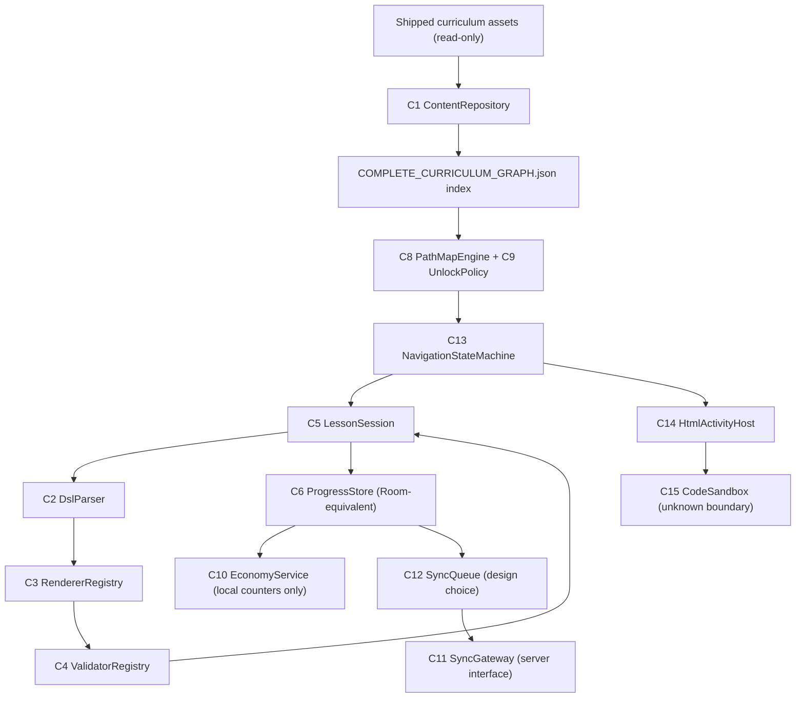

# INDEPENDENT OFFLINE-EQUIVALENT CLIENT — COMPLETE IMPLEMENTATION BLUEPRINT

**Document:** `COMPLETE_IMPLEMENTATION_BLUEPRINT.md` · **Mission:** MISSION 09 (final reconstruction) · **Branch:** `arena/aebb90b7-game`
**Target APK:** `com.getmimo` 9.35, `versionCode=1792759685`, 142,353,499 B, SHA-256 `48ce1740aa4b1f892a267ae54199d514d929b97e947b612f4e53c3571e0f7c7a` — unchanged.
**SERVER CONFIRMED = 0.** Classification vocabulary: `VERIFIED_STATIC`, `VERIFIED_RUNTIME`, `VERIFIED_ASSET`, `VERIFIED_DATABASE`, `VERIFIED_NETWORK_OBSERVATION`, `INFERRED`, `UNKNOWN`, `SERVER_DEPENDENT`.
Evidence codes resolve in `COMPLETE_EVIDENCE_DATABASE.json` / `COMPLETE_SYSTEM_MAP.json -> evidence_index`.

---


## 0. Goal and honesty contract

Build a **new, independent** offline learning client that reproduces the **observed
client-side behaviour** of Mimo 9.35 using the shipped curriculum assets. It does **not**
copy proprietary backend infrastructure, does not pretend to reproduce server-authoritative
values, and never presents an independent design choice as Mimo behaviour.
`SERVER CONFIRMED = 0`. This document is detailed enough that an implementer need not
reopen the APK.

Legend: **[O]** = original observed behaviour (evidence class given);
**[D]** = independent design decision (clearly labelled);
**[U]** = genuinely unknown / server-owned → interface + offline fallback only.

## 1. Component list (exact contracts)

| # | Component | Responsibility | Inputs | Outputs | Evidence |
|---|---|---|---|---|---|
| C1 | `ContentRepository` | load/validate shipped curriculum | `assets/lessons-<locale>/tracks/*.json` | `Track/Section/Tutorial/Chapter/Lesson` graph | [O] VERIFIED_ASSET, E23 |
| C2 | `DslParser` | HTML/XML DSL -> typed modules | `lesson.interactiveContent` | `List<Module>` | [O] VERIFIED_RUNTIME, A15 |
| C3 | `RendererRegistry` | module family -> renderer | `List<Module>` | `InteractionType` + view | [O] VERIFIED_RUNTIME/ASSET, A16 |
| C4 | `ValidatorRegistry` | per-family exact validation | user input + lesson | `Boolean` + answer string | [O] VERIFIED_RUNTIME/STATIC, A6–A11 |
| C5 | `LessonSession` | attempts/tries/feedback/advance | `LessonBundle` | `LessonProgress` | [O] VERIFIED_RUNTIME, A1–A5 |
| C6 | `ProgressStore` | Room-equivalent 3 tables | `LessonProgress` | rows/queries | [O] VERIFIED_DATABASE, E27 |
| C7 | `SettingsStore` | settings/prefs/flags | key/value | typed values | [O] VERIFIED_DATABASE, E13 |
| C8 | `PathMapEngine` | section/tutorial/chapter status | local state | `Status` enum | [O] shape, [U] exact boolean |
| C9 | `UnlockPolicy` (interface) | tier/keys gate | progress, tier, keys | `Status` | [U] UNKNOWN + SERVER_DEPENDENT |
| C10 | `EconomyService` | counters + cached display | progress rows | counters | [O] F1–F12, [U] awards |
| C11 | `NetworkGateway` (interface) | optional sync | queued rows | ack | [U] SERVER_DEPENDENT |
| C12 | `SyncQueue` | durable offline queue | progress row | sync op | **[D]** independent choice |
| C13 | `NavigationStateMachine` | screens/tabs/back | UI events | screen state | [O] VERIFIED_RUNTIME, E29 |
| C14 | `HtmlActivityHost` | WebView lessons + bridge | HTML, JS messages | `activity.correct/wrong/completed` | [O] asset, [U] native side |
| C15 | `CodeSandbox` (interface) | optional local execution | code files | output | [U] UNKNOWN |
| C16 | `Telemetry` (optional) | local-only counters | events | local rows | [D] |

## 2. Data contracts (implement verbatim)

```json
// Track (from tracks.json, v753)
{"id": 219, "title": "...", "version": 82,
 "sections": [{"name":"...", "description":"...", "startIndex":0, "endIndex":10,
               "tutorialIds":["904","..."]}]}

// Tutorial root (NOTE: wrapped)
{"tutorial": {"id":904,"version":161,"type":"course","codeLanguage":"html",
  "title":"Discovering HTML and Tags","showInTrack":true,
  "chapters":[{"id":17742,"title":"...","type":"practiceLevel1",
    "lessons":[{"id":151403,"title":"...","contentType":"interactive",
      "images":[],"interactiveContent":"<p>...</p><webview .../>",
      "hardModeSelected":false,"hardModeContent":null,"executableContent":null}]}]}}

// LessonProgress (11 fields, PK(lesson_id,tutorial_id))
{"lesson_id":151403,"completed_at":1793883744787,"started_at":1793883713744,
 "tries":1,"tutorial_id":904,"tutorial_version":161,"track_id":219,
 "publish_set_version":753,"attempts":1,"is_practice_progress":0,"in_queue":1}
```

`COMPLETE_CURRICULUM_GRAPH.json` is the ready-made normalized index: 19 tracks,
144 sections, 1,029 tutorials, 1,947 chapters, 18,272 unique lessons, 37,183 placements,
each with `rendererFamilies`, `asset`, `prerequisiteLessonId`, `prerequisiteChapterId`.
**Do not modify the original extracted assets** [O].

## 3. Core pseudocode (behavioural fidelity required)

```text
// C1 ContentRepository  [O]
load(root="lessons-en/tracks"):
    tracks = parseJson(root + "/tracks.json")
    for each section: assert endIndex-startIndex+1 == len(tutorialIds)
    for each id: tutorial = parseJson(root + "/tutorial-"+id+".json")["tutorial"]
    build index; report (never repair) parse failures / missing refs / duplicates
    // measured: 10,298 tutorial files, 0 parse failures, 0 missing refs, 0 duplicates

// C2 DslParser  [O] A15
parse(html):
    parser = XmlPullParser(namespaceAware=true)
    for START_TAG:
        p -> Paragraph; code -> Code; selection -> Selection(+items)
        img -> Image; webview -> Webview; database -> Database
        html/body/unknown -> SKIP
    on malformed XML -> return []     // slide

// C4 ValidatorRegistry  [O] A6..A11 (exact, no cleanup)
fillTheGap(selected, correct):
    return len(selected)==len(correct) and all(selected[i].text==correct[i].text)
selection(items):            return all(i.selected == i.isCorrect)
spell(typed, expected):      return len(typed)==len(expected) and all(typed[i].text==expected[i].text)
normalize(s):                return "".join(c for c in s.lower(Locale.US)
                                if c.isLetterOrDigit() or c in KEEP)  // KEEP=[< > ( ) : { } , .]
validatedInput(user, expected):
    if normalize(user)!=normalize(expected): return WRONG
    if user==expected: return EXACT
    return PARTIAL
executable(userFiles, shipped): return userFiles.content == shipped.files.solvedContent
isSolvedCorrectly(row):       return row.tries >= 1     // NOT attempts

// C5 LessonSession  [O] A1..A5
onSubmit(ok):
    if runInProgress: return
    runInProgress = true
    attempts += 1
    tries = ok ? 1 : 0                    // wrongLatch path in original: 0
    progress = LessonProgress(bundle, tries, attempts, now(), inQueue=true)
    store.upsert(progress)                // PK(lesson_id,tutorial_id)
    if ok: showCorrectFeedback() else showWrongFeedback()
    counters = AnswersInChapter(correct=count(isSolvedCorrectly), total=count(rows))
    nextPage = bundle.chapterIndex
    runInProgress = false
onContinue(slide):                         // noninteractive / reveal
    store.upsert(LessonProgress(bundle, 1, 1, now(), inQueue=true))
    advance(nextLesson(bundle))

// C8 PathMapEngine  [O] shape / [U] exact boolean
function status(t, c, p, tier, keys, dev):
    if p.tutorialCompleted: return COMPLETED
    if noLocalProgress(p) and !sequentialPrerequisitesMet(t): return LOCKED
    if unlockPolicy.fails(t, c, p, tier, keys, dev): return UNLOCKED_BUT_NO_KEYS
    return UNLOCKED
// verified sub-rule only:
hasKey(keys, trackId, tutorialId, chapterId) =
        keys.contains(trackId + ":" + tutorialId + ":" + chapterId)
// [D] offline fallback: unlockPolicy.fails = false; tier ignored; keys empty.

// C13 NavigationStateMachine  [O]
startup -> IntroSlides -> Onboarding(NavHost) -> AuthGate(Skip) -> MainActivity -> ChapterActivity
MainActivity.setActive(routeId):
    2131361976 -> Path; 2131361974 -> Practice; 2131361973 -> Leaderboard; 2131361975 -> Profile
guest Practice -> "Create a profile to access practice content"   // UI-only gate
back from lesson -> quit dialog -> Path
cold start offline -> IntroSlides; local Room state persists
```

## 4. Server-owned interfaces and offline fallbacks (no invented behaviour)

```text
interface UnlockPolicy {                 // [U] original predicate UNKNOWN
    Status evaluate(Tutorial, Chapter, LocalProgress, Tier, Set<Key>, DevOverrides);
}
interface AwardPolicy {                  // [U] no original formula exists
    // Any XP/coin/streak rule here is an INDEPENDENT DESIGN CHOICE.
}
interface SyncGateway {                  // [U] no response ever observed
    suspend fun post(rows: List<LessonProgress>): Result
    // [D] offline fallback: keep rows in durable SyncQueue, never delete them.
}
interface CodeSandbox {                  // [U] remote runner boundary UNKNOWN
    // [D] optional local sandbox; offline validator remains q.I() (A11).
}
```

**[D] Deliberate deviations from Mimo 9.35** (must be labelled in the implementation):
1. Mimo executes `DELETE FROM lesson_progress WHERE in_queue = 1` at startup [O
   VERIFIED_RUNTIME, M09 SQL seq 260], which discards unsynced progress. The independent
   client uses a **durable** `sync_operation` table instead. This is a design choice, not
   original behaviour.
2. Mimo gates absolute awards behind remote repositories. The independent client computes
   only F1–F12 local counters; any award formula is opt-in and explicitly labelled.
3. Mimo's `UnlockPolicy` is unknown. The independent client unlocks on local sequential
   prerequisites only.
4. Mimo's native WebView bridge object is unknown. The independent client defines its own
   `postMessage({kind, documentID, ...})` schema modelled on the **shipped JS asset**.

## 5. Screen / interaction acceptance tests (deterministic, no APK needed)

| ID | Given | Action | Then |
|---|---|---|---|
| AT-01 | fresh install | cold start | IntroSlides with `Get started`; Room `user_version=2`, identity `2b8ab6d303d9a501bd8c8fb78d8352fc` |
| AT-02 | fresh install, skip auth | open Learn | track 50 or 219 sections rendered from shipped JSON, offline |
| AT-03 | lesson 67443 selection | select only the `correct="true"` item | `selection()` true, `Correct!`, row `tries=1, attempts=1, in_queue=1` |
| AT-04 | same lesson | select a `correct="false"` item | `Try again`, `tries=0`, `attempts` incremented, no advance |
| AT-05 | lesson 151403 WebView | wrong `Q` then correct `D` | wrong feedback then `Correct!` + `D O G`; one row with `tries=1` |
| AT-06 | validatedInput lesson | `"<button>  LIKE</button>"` vs `"<button>Like</button>"` | normalize mismatch on case -> WRONG (case-sensitive after Locale.US lower of BOTH; exact-match branch otherwise) |
| AT-07 | fillTheGap | tokens in wrong order | false even if the set of tokens is identical |
| AT-08 | executable lesson | content differs from `solvedContent` by one space | false (`List.equals` is exact) |
| AT-09 | 2 queued rows | force-stop + cold start **offline** | both rows still present (independent durable queue) |
| AT-10 | guest | tap Practice | `Create a profile to access practice content`; zero network calls |
| AT-11 | guest | open streak view | no fabricated streak; empty/placeholder state, zero network calls |
| AT-12 | any lesson | complete offline | `coinBalance()` unchanged; `AnswersInChapter` equals F2/F3/F5 |
| AT-13 | full curriculum | validate index | 10,298 files parse, 0 missing refs, 0 duplicates, 0 orphan files, 4 locales with 2 extra tutorials reported |
| AT-14 | malformed DSL | parse | `[]` -> noninteractive slide, no crash |
| AT-15 | back from lesson | quit | dialog -> Path, session discarded |

## 6. Reference architecture for the independent client



## 7. Definition of done

An implementation passes AT-01..AT-15 with zero network access, ships no server response,
labels every **[D]** and **[U]** decision, keeps the curriculum assets unmodified, and
separates `VERIFIED_*`, `INFERRED`, `UNKNOWN`, `SERVER_DEPENDENT` in its own documentation.
No claim of 100% reverse engineering is made.
