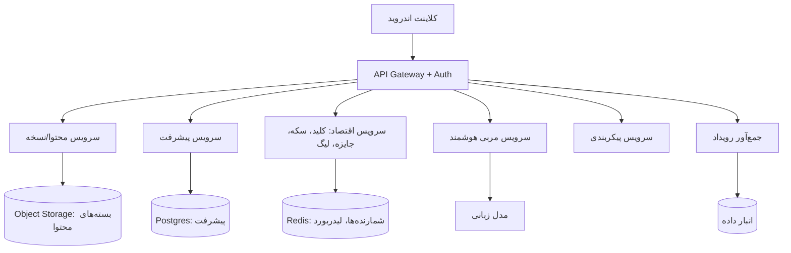

# سناریوی عملیاتی و مدیریتی میمو ۹.۳۵
### سند عملیاتی، مدیریتی و پیاده‌سازی — بر پایهٔ تحلیل ایستای شواهد‌محور بستهٔ اندروید `com.getmimo` نسخهٔ ۹.۳۵

> **دامنهٔ سند:** این سند *سناریوی عملیاتی* است، نه گزارش مهندسی معکوس. همهٔ اعداد واقعیِ اندازه‌گیری‌شده از بستهٔ نصب‌شده استخراج شده‌اند؛ اما رفتار سرور، قیمت‌گذاری و الگوریتم‌های تصمیم‌گیری که در بسته قابل مشاهده نیستند، با نشانهٔ «فرض/استنباط» مشخص شده‌اند. جزئیات فنی و شواهد در `final/00` تا `final/21` آمده است.

---

## ۱. محصول در یک نگاه

| موضوع | مقدار واقعی (اندازه‌گیری‌شده) |
|---|---|
| بستهٔ نصب | ۱۴۲,۳۵۳,۴۹۹ بایت — ۱۲ فایل DEX — ۲۹,۴۵۴ کلاس |
| محتوا | ۱۹ مسیر، ۱,۰۲۹ آموزش، ۱,۹۴۷ فصل، ۱۸,۲۷۲ جایگاه درس |
| مراحل سنجش | ۱۳,۰۲۷ مرحله (۸,۲۷۶ تعامل + ۴,۷۵۱ انتخاب چندگزینه‌ای) |
| درس‌های کدنویسی | ۴,۰۲۴ درس، ۶,۷۴۶ فایل |
| زبان‌ها | ۱۰ بستهٔ محتوایی کامل (`publishSetVersion = 753`) |
| ارزها | XP (Sparks)، سکه، کلید، زنجیره (Streak)، لیگ |
| قرارداد سرور | ۷۱ مسیر API، ۳۰۵ رویداد تحلیلی |

**جملهٔ محوری:** میمو یک «کلاینت نازک برای یک بک‌اند چاقِ محتوا و اقتصاد» است. کل دوره‌ها از قبل داخل APK هستند؛ سرور فقط نسخه، وضعیت، اقتصاد و مجوزها را کنترل می‌کند.

---

## ۲. مسیر کاربر (سناریوی پایان‌به‌پایان)

```
نصب → Splash (روتر لینک عمیق) → احراز هویت (یا ورود مهمان)
     → ۱۲ گام آنبوردینگ (انگیزه، شغل، تجربه، انتخاب مسیر، دستگاه، هدف روزانه)
     → ساخت «برنامهٔ تطبیقی» ← [فرض] سرویس سمت سرور
     → صفحهٔ مسیر → فصل → درس (تعاملی | کدنویسی) → پایان فصل (جایزه)
     → تمرین هوشمند / فروشگاه / پروفایل / گواهی
```

نکات عملیاتی که مستقیماً روی تیم پشتیبانی و محصول اثر دارد:

1. **ورود بدون حساب ممکن است** (ثبت‌نام معوق). یعنی کاربر می‌تواند درس بخواند و بعداً حساب بسازد؛ هر عملیاتی که به هویت نیاز دارد (لیگ، دوستان، گواهی) تا آن لحظه غیرفعال است.
2. **حالت مهمان/آفلاین باعث می‌شود «کلید» و «زنجیره» دیده شوند ولی نتوانند تغییر کنند** (فرض، چون منبع آن‌ها سرور است).
3. **اجرای کد بدون اینترنت ممکن نیست**؛ ولی درس تعاملی کاملاً آفلاین تصحیح می‌شود. این تفاوت باید در متن راهنما و آموزش پشتیبانی صریح باشد.

---

## ۳. معماری نمونهٔ بک‌اند (پیشنهادی و قابل دفاع)


خدمات جانبی که در بسته دیده می‌شوند و در نسخهٔ ایرانی باید جایگزین شوند: RevenueCat (خرید)،
Adjust (اتریبیوشن)، Customer.io (پیام چرخهٔ عمر)، Firebase (احراز هویت/پیکربندی/پوش).

---

## ۴. پنل مدیریت (طراحی پیشنهادی)

پنل باید چهار «واحد کاری» داشته باشد، وگرنه به ابزار ویرایش متن تبدیل می‌شود:

### ۴.۱ استودیوی محتوا
- ویرایشگر مارک‌آپ درس با **اعتبارسنجی زندهٔ قاعده‌ها**: بازه‌های `startIndex/endIndex` باید داخل متن کد باشند (در بستهٔ اصلی ۱۷٫۵۲۶ از ۱۷٫۵۲۶ بازه معتبر است — یعنی اعتبارسنج خودکار وجود دارد).
- پیش‌نمایش سمت سرور (`/v1/tutorials/drafts/.../render` در محصول اصلی) + پیش‌نمایش روی دستگاه.
- علامت‌گذاری نسخه در سه سطح: بستهٔ انتشار، مسیر، آموزش. اصلاح یک درس نباید نسخهٔ کل بسته را عوض کند.

### ۴.۲ خط انتشار
| وضعیت | معنی | اجازهٔ چه کسی |
|---|---|---|
| پیش‌نویس | فقط نویسنده | نویسنده |
| بازبینی | فقط ویرایشگر | ویرایشگر محتوا |
| آمادهٔ انتشار | در بستهٔ بعدی | سرپرست محتوا |
| منتشرشده | در دسترس کاربر | خودکار |

**قاعدهٔ دو‌نفره برای هر تغییر در «کلید پاسخ»** — تجربهٔ میمو نشان می‌دهد ۴۲ درس کدنویسی بدون پاسخ مرجع در بسته مانده‌اند؛ یعنی اعتبارسنج فقط «ارجاع‌های شکسته» را می‌گیرد، نه «کیفیت پاسخ» را.

### ۴.۳ اتاق فرمان اقتصاد و آزمایش
- ویرایش امتیاز درس، ضریب جایزه، سهمیهٔ کلید روزانه.
- **پیکربندی کامل پیشنهاد تخفیف از راه دور** (عنوان، متن، تصویر روشن/تیره، انیمیشن، شمارندهٔ معکوس، CTA، CTA رد کردن). در میمو این کل شیء از سرور می‌آید و همین باعث می‌شود کمپین قیمتی بدون انتشار نسخه اجرا شود.
- نسخه‌بندی آزمایش: «مسیر ۵۰ را با مسیر ۸۰ برای ۱۰٪ کاربران جایگزین کن» + امکان توقف فوری.

### ۴.۴ عملیات و پشتیبانی
- جست‌وجوی کاربر، مشاهدهٔ وضعیت پیشرفت، ارسال کلید/جایزهٔ جبرانی.
- صف «پیشرفت‌های همگام‌نشده» و نرخ خطای همگام‌سازی.
- گزارش‌های درس مشکل‌دار (typo، محتوای گیج‌کننده، ایراد اپ) — در محصول اصلی سه دلیل گزارش وجود دارد.

---

## ۵. رویه‌های عملیاتی (Runbook)

**۵.۱ انتشار بستهٔ محتوا**
1. اعتبارسنجی خودکار: طرح‌واره + بازه‌ها + ارجاع‌ها + وجود پاسخ مرجع.
2. تولید بسته، محاسبهٔ هش، امضا.
3. انتشار برای ۵٪ کاربران (آزمایش محتوا).
4. پایش ۲۴ ساعته: نرخ شکست درس، نرخ گزارش، نرخ ترک فصل.
5. انتشار کامل یا بازگشت.

**۵.۲ اصلاح یک پاسخ غلط (حادثهٔ اعتباری)**
1. توقف توزیع بستهٔ معیوب.
2. تعیین نسخهٔ دروس متأثر از `(lessonId, tutorialId, tutorialVersion, publishSetVersion)`.
3. اصلاح + انتشار.
4. تصمیم دربارهٔ پیشرفت کاربران: نگه‌داشتن، بازپرسش، یا بخشودن. **بدون این تصمیم، اصلاح محتوا به داده‌های کاربر آسیب می‌زند.**

**۵.۳ قطعی سرور**
کلاینت درس تعاملی را ادامه می‌دهد، پیشرفت را صف می‌کند و در هر سطح پیام آفلاین مخصوص همان سطح را نشان می‌دهد (در بسته ۱۴ رشتهٔ آفلاین مجزا وجود دارد). برای همان رفتار، «صف قابل مشاهده» اضافه شود.

---

## ۶. شاخص‌ها (KPI) و نقاط تصمیم

| لایه | شاخص | از کجا |
|---|---|---|
| Acquisition | نصب، اتریبیوشن کمپین | Adjust/`marketing_campaign` |
| Activation | تکمیل آنبوردینگ، انتخاب مسیر | رویدادهای `onboarding_*` |
| Engagement | درس در روز، هدف روزانه، حالت سریع | Sparks/`daily_goal` |
| Retention | زنجیره، چالش زنجیره، بازفعال‌سازی | `streak_challenge_*`, `reactivation_*` |
| Monetisation | نمایش پی‌وال، شروع آزمایشی، خرید، تخفیف | `PaywallTrackingSource` (۱۳+ منبع) |
| Learning | نرخ قبولی درس، نرخ «دیدن راه‌حل»، تلاش دوم | `attempts`/`tries`, `seeSolutionWasUsed` |
| Content | گزارش درس، نرخ شکست به تفکیک فصل | گزارش درس + پیشرفت |

نکتهٔ مدیریتی: میمو «نرخ یادگیری» را با «نرخ قبولی» می‌سنجد؛ این معیار فریبنده است. برای محصول آموزشی، معیار درست «بازگشت به همان مفهوم پس از ۷ روز» است.

---

## ۷. نقش‌ها و اختیارات

| نقش | اختیار |
|---|---|
| نویسندهٔ محتوا | پیش‌نویس، پیش‌نمایش |
| ویرایشگر آموزشی | تأیید محتوایی، بازبینی پاسخ‌ها |
| سرپرست محتوا | انتشار، آزمایش محتوا، بازگشت |
| مدیر محصول | پرچم‌ها، آزمایش‌ها، پیشنهاد قیمتی |
| مهندس عملیات | دسترسی به کنسول داخلی (در نسخهٔ تولید بسته نشود) |
| پشتیبانی | جست‌وجوی کاربر، جبران کلید/جایزه |

درس عبرت امنیتی: میمو **۵۵ کلاس «منوی توسعه‌دهنده» را در نسخهٔ تولید منتشر کرده** (شامل دانلود محتوای منتشرنشده و بازنویسی هر پرچم). این ابزار برای تیم لازم است، اما باید در بیلد داخلی بماند.

---

## ۸. برنامهٔ ۹۰ روزهٔ پیاده‌سازی

| بازه | تحویل‌دادنی |
|---|---|
| روز ۱–۱۵ | طرح‌وارهٔ DSL + موتور تصحیح آفست + ۵۰۰ تست نرمال‌سازی فارسی |
| روز ۱۶–۳۵ | مدل محتوا (مسیر/بخش/آموزش/فصل/درس) + پنل استودیوی محتوا |
| روز ۳۶–۵۰ | خط انتشار + نسخه‌بندی سه‌سطحی + پیش‌نمایش روی دستگاه |
| روز ۵۱–۶۵ | اقتصاد: XP، زنجیره، اعتبار جایگزین کلید + سرویس مجوز |
| روز ۶۶–۸۰ | آزمون (حالت B): زمان‌سنج، نمرهٔ منفی، نسخهٔ کلید پاسخ |
| روز ۸۱–۹۰ | مسیر کارت‌محور (حالت C) بر پایهٔ مدل ضعف + پایش و داشبورد |

---

## ۹. ده تصمیم مدیریتی که باید صریح گرفته شود

1. محتوا داخل اپ می‌ماند یا دانلودی می‌شود؟ (میمو: داخل اپ؛ کنکور: دانلودی و امضاشده.)
2. آیا «کلید» می‌تواند درس اصلی را ببندد؟ (توصیه: هرگز.)
3. مدل ضعف کجا محاسبه می‌شود؟ (توصیه: هم‌زمان روی دستگاه و سرور.)
4. آیا خروجی آزمون آفلاین قابل اعتماد است؟ (پاسخ: فقط با امضای بسته و هش نتیجه.)
5. یک صفحهٔ پرچم یا سه صفحه؟ (توصیه: یکی، با قاعدهٔ تقدم مکتوب.)
6. مربی هوشمند: دستیار مفهومی یا حل‌کنندهٔ سؤال؟ (توصیه: اولی.)
7. سیاست نرمال‌سازی فارسی: چه کسی مالک آن است؟
8. تعریف «درس تمام‌شده» در آمار محصول چیست؟
9. سیاست اصلاح کلید پاسخ پس از انتشار چیست؟
10. کدام ابزارهای داخلی اجازهٔ ورود به بیلد تولید دارند؟

---

## ۱۰. جمع‌بندی

میمو نشان می‌دهد یک محصول آموزشی موبایل می‌تواند با **گرامر کوچک درس + تصحیح آفست + محتوای نسخه‌دار** به ۱۸ هزار درس برسد. آنچه در میمو وجود ندارد و برای کنکور حیاتی است: **مهلت**، **وزن دفترچهٔ آزمون**، **نمرهٔ منفی** و **مدل ضعف**. سناریوی عملیاتی بالا دقیقاً همان چهار شکاف را با فرایند و پنل پر می‌کند.
