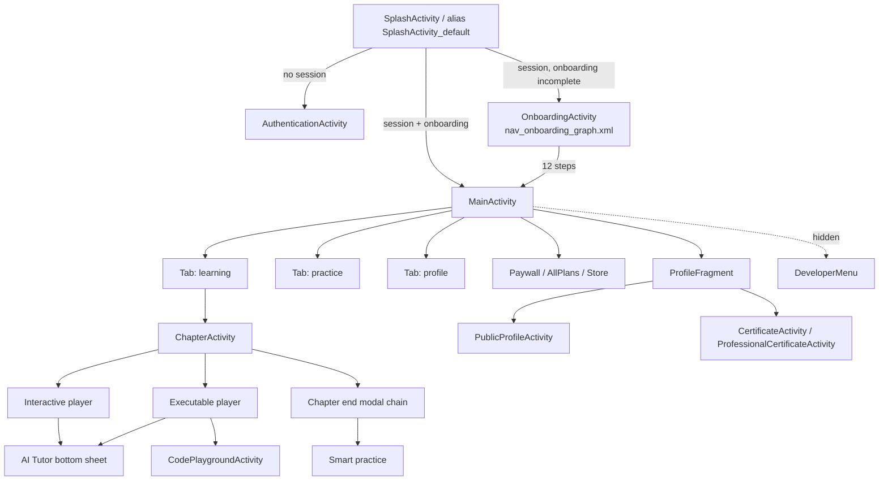

# ۰۳ج — نقشهٔ ناوبری

## قواعد ناوبری (شاهد)

| قاعده | شاهد | اطمینان |
|---|---|---|
| تنها یک گراف ناوبری اعلانی وجود دارد (آنبوردینگ) | `nav_onboarding_graph.xml` | HIGH |
| بقیهٔ ناوبری imperative است (Intent/Fragment) | ۶۱ activity، فقط ۱ graph | HIGH |
| تب‌ها می‌توانند پنهان/نمایش/بج شوند | `NavigationBar$listenToTabVisibilityChanges` | HIGH |
| انتخاب تب پس از kill شدن فرایند حفظ می‌شود | `NavigationBar$NavigationBarSavedState` | MEDIUM |
| لینک `/learn/.*` هر مسیری را می‌پذیرد | manifest pathPattern | HIGH |
| پایان فصل یک زنجیرهٔ modal است، نه صفحه | `ModalData$*` + `reward_drag_to_dismiss` | MEDIUM |

## آنچه نیاز به اجرا دارد (NOT_TESTED)

* رفتار Back در میانهٔ زنجیرهٔ مودال.
* بازگشت از deep link به درس نیمه‌تمام (بازسازی context از Room).
* ترتیب واقعی تب‌ها و برچسب‌ها.
