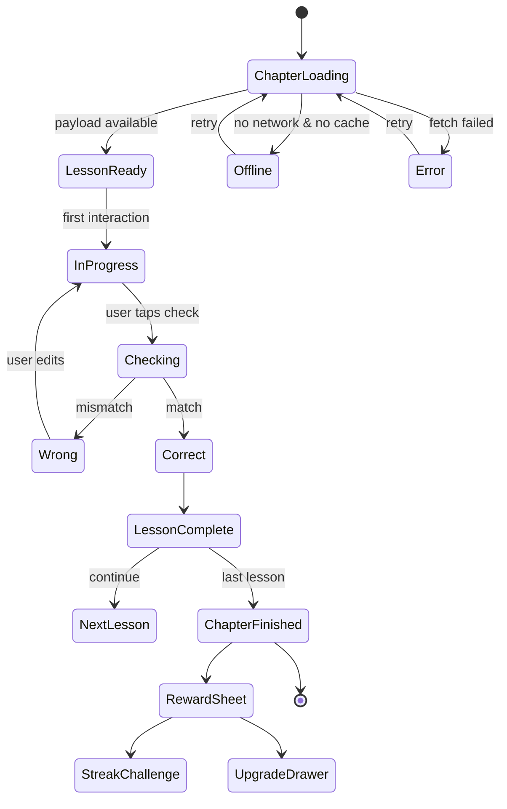
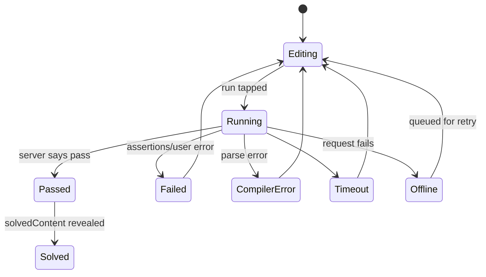

# ۰۶ — ماشین حالت اجرای درس

**وضعیت:** ساختار `VERIFIED_STATIC` (کلاس‌های ViewModel/State + رشته‌ها)؛ **گذارها `INFERRED`** —
هیچ اجرایی انجام نشده است.

## ۱. وضعیت‌های شناسایی‌شده

## ۲. نگاشت وضعیت‌ها به شاهد

| وضعیت | شاهد در بسته | اطمینان |
|---|---|---|
| `ChapterLoading` | `chapter_*loading*`، `ChapterViewModel$State` | MEDIUM |
| `Offline` | ۱۴ رشتهٔ `*_offline_*` (خانه، فصل، تمرین، فروشگاه، لیدربورد، پروفایل، مربی) | HIGH |
| `Wrong` | `p visible-if="wrong"` (۱۹,۱۰۱) + `try_again*` | HIGH |
| `Correct` | `p visible-if="correct"` (۸۵) + `lesson_completed*` | HIGH |
| `ChapterFinished` | ۵۲ رشتهٔ `chapter_end_*` | MEDIUM |
| `RewardSheet` → `StreakChallenge` → `UpgradeDrawer` | `ModalData$*`, `reward_drag_to_dismiss`, `streak_challenge_prompt_accept` | MEDIUM |
| `Error` | `generic_error_retry` + ۷۱ رشتهٔ خطا | MEDIUM |

## ۳. قواعد ثابت (invariants) که پیاده‌سازی باید تضمین کند

| # | قاعده | چرا |
|---|---|---|
| I1 | بازخورد `wrong`/`correct` فقط **پس از** بررسی نمایش داده می‌شود | `visible_paragraphs()` در `tools/lesson_dsl.py` |
| I2 | یک بلوک تا وقتی همهٔ جای خالی‌ها پر نشده‌اند قابل بررسی نیست | ۲۹,۰۹۳ بازهٔ مستقل؛ در غیر این صورت UNANSWERED |
| I3 | خطا در یک جای خالی، کل بلوک را رد می‌کند | قرارداد داده (یک `visible-if` در سطح بلوک) |
| I4 | پیشرفت درس **قبل از** پایان فصل ثبت می‌شود | `lesson_progress` + outbox (بخش ۱۱) |
| I5 | خروج از درس در حالت `Wrong` باید قابل بازگشت باشد | `NavigationBar$NavigationBarSavedState` |

## ۴. اجرای کد (زیرماشین مستقل)

* `Sending`/`Running`/`Output` رشته‌ها موجودند (`code_header_console_*`, `input_console_*`).
* **UNKNOWN:** آستانهٔ timeout، تعداد تلاش، و اینکه نتیجهٔ اجرا server-side یا client-side سنجیده می‌شود.
