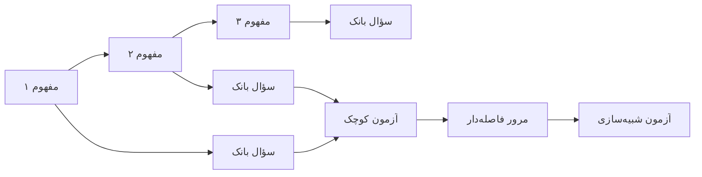

# ۰۷ب — گراف برنامهٔ درسی

## ۱. ساختار گراف (بازتولیدشده از ۱۰ بسته)

```
PublishSet
 └ Track ─┬─ Section (startIndex/endIndex)
          └ Tutorial ── Chapter ── Lesson
```
قواعد بازتولیدشده (همه ✅، بخش ۰۴):

1. `Section.startIndex` = مجموع طول بخش‌های قبل.
2. هر `tutorialId` در بخش‌ها به فایل موجود اشاره می‌کند (۰ ارجاع شکسته).
3. هر آموزش دقیقاً در یک بخش است (۰ آموزش یتیم).
4. ترتیب آموزش‌ها در بخش = ترتیب پیشنهادی گذر.

## ۲. پیش‌نیازها: چه چیزی در داده هست و چه چیزی نیست

| نیاز گراف | در داده؟ | شاهد |
|---|---|---|
| ترتیب (sequence) | ✅ | `Section.tutorialIds` |
| هم‌نیازی (واحد موضوعی) | ✅ ضمنی | `Section.name` |
| پیش‌نیاز صریح (A قبل از B) | ❌ | هیچ فیلدی وجود ندارد |
| هم‌نیاز متقابل (A و B با هم) | ❌ | — |
| اجباری/اختیاری | ✅ | `Tutorial.type` (`practiceRequired` vs `practiceOptional`) |
| دستهٔ آنبوردینگ | ✅ | `Track.onboardingCategory = build|none` |
| بومی‌سازی ترتیب | ⚠️ | بسته‌های بومی آموزش‌های اضافه دارند |

**نتیجه:** گراف واقعی، یک **درخت خطی** است با دو لبهٔ اختیاری (پروژه، تمرین تعمیق).
هیچ گراف پیش‌نیازی در Mimo وجود ندارد — و برای کنکور، این بزرگ‌ترین کمبود است.

## ۳. طرح گراف برای محصول هدف (پیشنهاد قابل ساخت)


تفاوت بنیادی: در Mimo «درس» پیش از «سؤال» است؛ در کنکور «سؤال» می‌تواند مستقل از درس باشد.
بنابراین گراف باید **دو نوع گره** داشته باشد (مفهوم، سؤال) و سه نوع لبه (پیش‌نیاز، پوشش، مرور).
