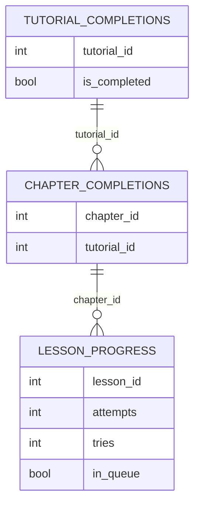

# ۱۱ — پایگاه دادهٔ محلی (Room)

**شواهد:** VERIFIED_STATIC از رشته‌های `Database_Impl` (نام جدول‌ها) و `toString()` کلاس‌های entity
(نام فیلدها). نام ستون‌ها از camelCase استنتاج شده است.

## ۱. سه جدول تأییدشده

```
Database_Impl → chapter_completions | lesson_progress | tutorial_completions
```

### `lesson_progress` — صف پیشرفت + تاریخچه

| فیلد | نوع | معنا |
|---|---|---|
| `lessonId` | Int | شناسهٔ درس |
| `tutorialId`, `chapterId`, `trackId` | Int | زمینه |
| `tutorialVersion` | Int | نسخهٔ آموزش |
| `publishSetVersion` | Int | نسخهٔ بستهٔ محتوا |
| `attempts` | Int | چند بار درس از سر گرفته شد |
| `tries` | Int | چند بار «بررسی» زده شد |
| `startedAt` / `completedAt` | زمان | شروع/پایان |
| `inQueue` | Boolean | آمادهٔ ارسال (outbox) |
| `isPracticeProgress` | Boolean | تمرین یا درس |

> **یافتهٔ تازه:** دو شمارندهٔ مستقل `attempts` و `tries` وجود دارد. تفکیک «شروع دوبارهٔ درس» از
> «تلاش درون درس» همان دادهٔ لازم برای مدل تسلط است؛ در گزارش قبلی فقط «۳ جدول» ثبت شده بود.

### `chapter_completions`
`chapterId`, `tutorialId`, `trackId`, `createdAt`

### `tutorial_completions`
`tutorialId`, `trackId`, `isCompleted`, `updatedAt`

## ۲. DDL بازسازی‌شده (قابل اجرا در Room)

```sql
CREATE TABLE IF NOT EXISTS lesson_progress (
  lesson_id INTEGER NOT NULL, tutorial_id INTEGER NOT NULL,
  chapter_id INTEGER NOT NULL, track_id INTEGER NOT NULL,
  tutorial_version INTEGER NOT NULL, publish_set_version INTEGER NOT NULL,
  attempts INTEGER NOT NULL DEFAULT 0, tries INTEGER NOT NULL DEFAULT 0,
  started_at TEXT, completed_at TEXT,
  in_queue INTEGER NOT NULL DEFAULT 0, is_practice_progress INTEGER NOT NULL DEFAULT 0,
  PRIMARY KEY (lesson_id, tutorial_id)
);
CREATE TABLE IF NOT EXISTS chapter_completions (
  chapter_id INTEGER NOT NULL PRIMARY KEY, tutorial_id INTEGER NOT NULL,
  track_id INTEGER NOT NULL, created_at TEXT NOT NULL
);
CREATE TABLE IF NOT EXISTS tutorial_completions (
  tutorial_id INTEGER NOT NULL PRIMARY KEY, track_id INTEGER NOT NULL,
  is_completed INTEGER NOT NULL DEFAULT 0, updated_at TEXT NOT NULL
);
CREATE INDEX IF NOT EXISTS idx_progress_queue ON lesson_progress(in_queue);
```

## ۳. ERD



## ۴. آنچه در پایگاه دادهٔ محلی نیست

| داده | محل واقعی |
|---|---|
| بستهٔ محتوا | assets/فایل (نه DB) |
| اعتبار، کلید، XP | سرور |
| گفتگوی مربی | سرور |
| تنظیمات | DataStore (۱۴۸ کلاس) |
| خرید/entitlement | RevenueCat |

⇒ پایگاه دادهٔ محلی کوچک و **بدون رمزنگاری** است (SQLCipher مشاهده نشد).
برای کنکور کافی نیست: بانک سؤال آفلاین، پاسخ‌های ذخیره‌شده و صف ارسال جدول بیشتری می‌خواهند.
