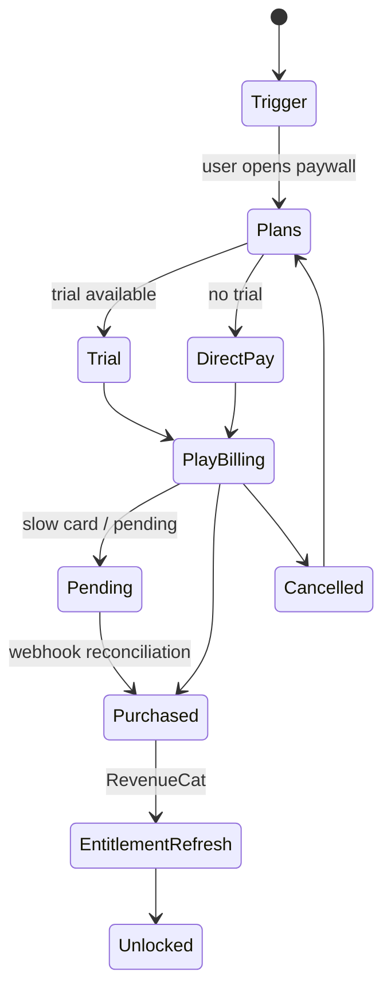

# ۱۲ب — جریان پی‌وال

| مرحله | شاهد |
|---|---|
| Plans | `AllPlansActivity`, ۳۹+۳۹ رشتهٔ طرح |
| Trial | `trial_*` رشته‌ها |
| Billing | مجوز BILLING + RevenueCat |
| Pending | `purchase_pending_*` |
| Cancel | `purchase_cancelled_*` |
| Restore | `restore_purchases_*` |
| Unlock | `UpgradeDrawer` بسته می‌شود + بنر موفقیت |

## نکات پیاده‌سازی (الزامی)

1. **Entitlement منبع حقیقت سرور است، نه Play.** پس از خرید، `/v1/account` و RevenueCat هر دو
   باید تأیید کنند؛ اگر اختلاف، سرور برنده.
2. **Pending** را نادیده نگیرید (کارت‌های اعتباری/کارت هدیه): وضعیت باید در UI بماند.
3. **Restore** باید همیشه دیده شود (الزام Google).
4. شمارش معکوس تخفیف باید سمت سرور باشد (`RemoteConfigDiscount`)، وگرنه دور زدنی است.
5. هیچ‌گاه قفل محتوا فقط کلاینتی نباشد.
