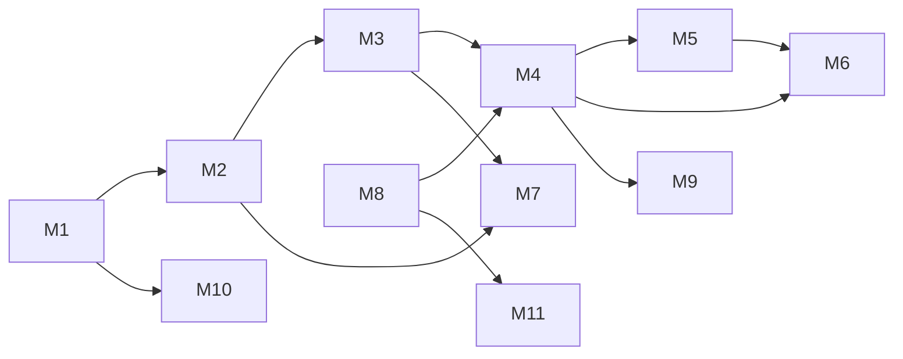

# ۱۷ — تجزیه به ماژول‌های قابل ساخت

هر ماژول: مسئولیت، ورودی/خروجی، وابستگی، معیار پذیرش، و «منبع الهام در Mimo».
اعداد «تخمین» فقط نسبی‌اند (نسبت به یک تیم ۴ نفرهٔ اندروید+بک‌اند).

| # | ماژول | مسئولیت | وابسته به | اندازه (نسبی) |
|---|---|---|---|---|
| M1 | Content Pipeline | تبدیل بانک سؤال/درس به بستهٔ نسخه‌دار + پارسر | M2 | L |
| M2 | Lesson DSL & Renderer | پارس، رندر، تعامل، بازخورد | M1 | **XL** |
| M3 | Grading Engine | تصحیح همهٔ انواع سؤال + تشخیص خطا | M2 | L |
| M4 | Progress & Mastery | پیشرفت، تسلط، مرور فاصله‌دار | M3 | L |
| M5 | Assessment/Exam | آزمون، زمان، تراز، رتبهٔ تخمینی | M3,M4 | XL |
| M6 | Analytics/Diagnostics | نقشهٔ ضعف، گزارش، پیش‌بینی | M4,M5 | M |
| M7 | Assistant | مربی هوشمند + حفاظ‌ها | M2,M3 | M |
| M8 | Identity & Entitlement | ورود، نقش‌ها، اشتراک | — | M |
| M9 | Offline & Sync | کش، صف، تعارض | M4 | M |
| M10 | Authoring/Publish | پنل تألیف + انتشار نسخه‌دار | M1 | L |
| M11 | Notifications | زمان‌بندی، قواعد، والد | M8 | S |
| M12 | Admin/Ops | پیکربندی، آزمایش، پایش | همه | M |

## وابستگی‌ها

## مقایسه با ماژول‌های Mimo (چه چیزی قابل انتقال است)

| ماژول | در Mimo وجود دارد | کیفیت | قابل انتقال؟ |
|---|---|---|---|
| M2 | ✅ (DSL + رندرر) | بالا (۲۰,۳۰۶ سند، ۰ خطا) | **الگو و قرارداد: بله**؛ کد: نه |
| M3 | ⚠️ جزئی (بدون بازخورد per-gap، بدون تشخیص) | متوسط | الگوریتم چک‌لیستی: بله |
| M4 | ⚠️ (پیشرفت هست، تسلط نامعلوم) | کم‌شفاف | فقط مدل داده |
| M5 | ❌ ندارد | — | **ساخت کامل** |
| M6 | ⚠️ (آمار تمرین) | کم | ساخت کامل با الهام |
| M7 | ✅ | متوسط (پرامپت در کلاینت) | الگوی ۹ قاعده: بله |
| M8 | ✅ | استاندارد | الگو: بله |
| M9 | ✅ (outbox) | متوسط | **الگو: بله** |
| M10 | ✅ (`/v1/tutorials/drafts/...`) | نامعلوم | فقط نشانه |
| M11 | ✅ | پرحجم | محدود |
| M12 | ✅ (RC + DevMenu) | متوسط | الگو |

**نتیجهٔ کلیدی:** Mimo برای M2/M9/M8 الگوی خوبی است؛ برای M5 (آزمون) هیچ چیز ندارد.
