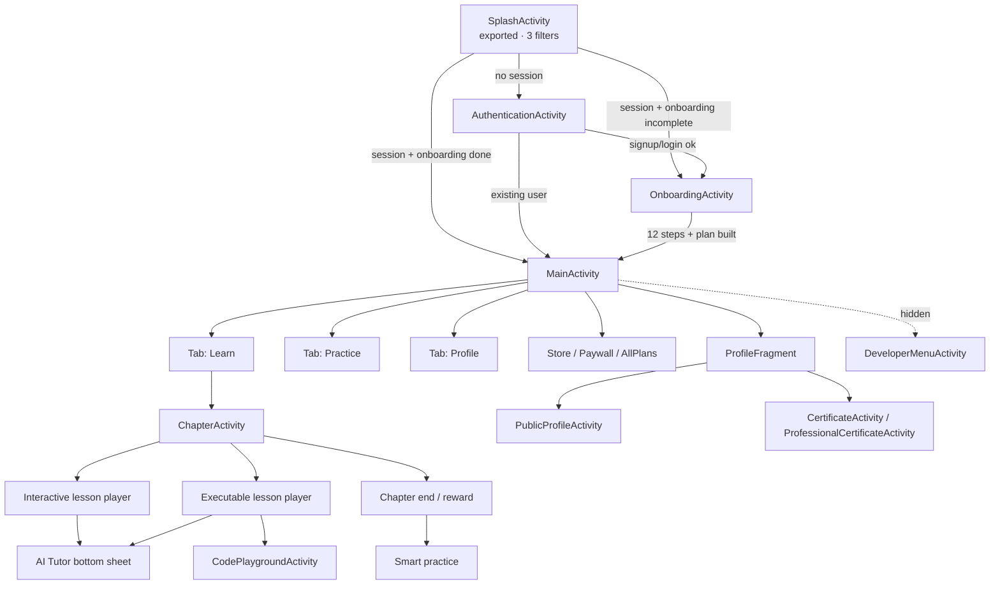

# 03 — Navigation graph and interaction model

## 1. Top-level structure

```
LauncherActivity: SplashActivity (exported, 3 filters)
   │  session? ──no──► AuthenticationActivity ──► OnboardingActivity (nav_onboarding_graph.xml)
   │  session? ──yes─► MainActivity (NavigationBar, tabs dynamic)
   │                     ├─ path/home  → ChapterActivity → lesson players
   │                     ├─ practice   → practice hub (fragments)
   │                     └─ profile    → ProfileFragment / PublicProfileActivity
   └─ deep link → login | register | continuelearning | support | profile | learn/*
```
Edges marked **V** are proven by manifest filters, class names or resource strings; the tab
composition is **I** (the tab set is computed at runtime; labels are not app strings).

## 2. Graph (Mermaid, editable)



## 3. Entry points (deep links, VERIFIED STATIC)

| URI | Target | Parameterisation |
|---|---|---|
| `https://getmimo.com/learn/.*` | `MainActivity` | `pathPattern` — arbitrary path suffix accepted |
| `https://getmimo.com/profile` | `MainActivity` | none |
| `https://getmimo.com/login`, `mimo://getmimo.com/login` | `SplashActivity` | none |
| `…/register` | `SplashActivity` | none |
| `…/deeplink/continuelearning` | `SplashActivity` | resume current lesson |
| `…/deeplink/support` | `SplashActivity` | support flow |
| `fbconnect://cct.com.getmimo` | `facebook.CustomTabActivity` | OAuth callback |
| `genericidp://firebase.auth/`, `recaptcha://firebase.auth/` | Firebase activities | `singleTask` |

Two observations that matter operationally:
1. **`/learn/.*` is a wildcard** — any `getmimo.com/learn/...` URL opens the app. That is the
   growth-loop link used by email/push campaigns; it means the *server* decides what "learn"
   maps to, not the client.
2. `SplashActivity` is the router for all "continue" flows, so cold-start attribution
   (Adjust) and the deep link are resolved in the same place — good pattern for a Konkur
   "resume study plan" link.

## 4. In-app navigation mechanics

| Mechanism | Evidence | Consequence |
|---|---|---|
| `NavigationBar` with `listenToTabChanges`, `listenToTabNotifications`, `listenToTabVisibilityChanges` | V (`ui.navigation.NavigationBar`) | Tabs can be **added, hidden, or badged at runtime** (server/policy driven) |
| `SavedStateHandle`-based state (`NavigationBar$NavigationBarSavedState`) | V | Tab selection survives process death |
| One navigation graph only (`nav_onboarding_graph.xml`) | V | The rest of the app navigates imperatively via Intents/Fragments — no single declarative graph |
| `WrapperFragmentActivity` | V | A generic host so fragments can be deep-linked as activities |
| 22 modal variants (`ModalData`) + 87 bottom sheets + 44 dialogs | V | The app's dominant "navigation" is actually **modal** traversal, not screen traversal |
| `ChapterActivity` holds lessons | V | Lesson-to-lesson movement does not create new activities (fast, animated) |

**The single most important interaction-design fact:** Mimo is a *modal-first* app. Between
two lessons the user can pass through a reward sheet, a streak challenge sheet, a reminder
prompt, an upgrade drawer, an AI-tutor suggestion and a notification permission modal, all
overlaid on `ChapterActivity` without navigation. Any port must copy this container model,
or the retention loop breaks.

## 5. Interaction primitives (tap → feedback)

| Primitive | Where | Feedback contract |
|---|---|---|
| Chip tap into gap | interactive module | gap fills, chip consumed, check enabled |
| Text entry | `validatedInput` | on check: **partial-match** feedback exists (`validated_input_partial_match_feedback_text_the_correct_answer_is`) |
| Option tap | `selection` | highlight, multi-select, check |
| Run code | executable | spinner in console header, then `n/m checks passed` |
| See solution | executable | confirm dialog → side-by-side diff (`see_solution_user_code` / `see_solution_our_solution`) |
| Ask AI tutor | both | bottom sheet, 5 free questions, then upgrade sheet |
| Report lesson | any | bottom sheet with reasons (`report_lesson_option_content_typo`, `…_content_confusing`, `…_app_issue`) |
| Drag sheet down | modals | `reward_drag_to_dismiss` |

## 6. Back-stack and interruption rules (I unless noted)

* Cold start from a push/deep link **into a lesson** is allowed (`/learn/*` → MainActivity);
  the app then rebuilds chapter context from Room progress rather than from the URL (I).
* Interrupting a lesson (home button, sheet) does not lose code: autosave is continuous (V
  class `AutoSaveCodeService`; `savedFiles` literals).
* Chapter end is a *modal chain*, so `Back` dismisses the chain, not the chapter — this is why
  `reward_drag_to_dismiss` exists as an affordance (I, string-grounded).
* Offline: navigation into a networked surface is not blocked; the surface renders its
  `*_offline_*` variant with a manual refresh (`offline_view_refresh`) (V strings).

## 7. Navigation anti-patterns to avoid in a port

1. `SplashActivity` as universal router + 6 deep-link variants: works, but couples
   attribution, auth and routing. A Konkur app should use one typed route resolver.
2. Only one declarative nav graph, for onboarding only. Onboarding is thus the *only*
   navigable-by-graph area; everything else is imperative Intents. Cost: 61 activities.
3. 87 bottom-sheet classes for a mobile app implies heavy ad-hoc UI composition; the modal
   variants are typed (`ModalData`) but the sheets are not, so sheet behaviour varies.
