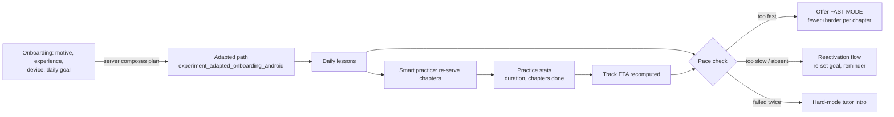

# 09 — Practice, difficulty and adaptive progression

Mimo has **four separate difficulty mechanisms** that are often confused in product
discussions. This section separates them, because only two of them are actually adaptive.

| # | Mechanism | Granularity | Adaptive? | Evidence |
|---|---|---|---|---|
| 1 | Chapter level `practiceLevel1..3` / `challengeLevel0..2` | chapter | **No** — authored | Content corpus, 6 chapter types; 11,373 / 2,362 / 4,096 lessons |
| 2 | **Hard mode** (`hardModeContent` variants) | lesson | No — learner opt-in, per lesson | 6,058 lessons; `experiment_hardmode_v2_android` |
| 3 | **Fast mode** | chapter | **Yes** — triggered by learner pace | 26 `fast_mode_*` strings |
| 4 | **Smart practice** | chapter selection | Yes — server chooses what to re-drill | `SmartPractice*` modals, `/v1/practice/statistics` |

---

## 1. The practice hub

**What it offers** (V strings): real-life scenarios, review & reinforcement,
problem-solving; filters on *completion status*, *paths*, *content type*; a
"Hide completed" toggle; free-text search with a dedicated no-results state; plus
`practice_stats`-driven figures.

**What it actually is** (V contract): practice content is **re-served existing chapters**, not a
separate corpus. `PracticeContentResponse(chapterId, trackId, tutorialId)` carries only
identifiers — the client then loads that chapter from the shipped pack. That is why the practice
hub can cover 1,947 chapters instantly and why "practice" never grows the content size.

**Statistics** (V): `PracticeStatsResponse(duration, chaptersCompleted)` — two metrics only:
time spent and chapters completed. No accuracy, no per-topic weakness, no difficulty rating.

**Smart practice** (V): `SmartPracticeChargedModal`, `SmartPracticeMasteredModal` — a
consumption-gated flow (charged) that ends in a mastery claim. The selection logic is
server-side (**I**); the only local input available to it is progress + practice statistics.

**Offline** (V): `practice_offline_*`; practice therefore needs the network for *selection* but
not for *rendering* the chosen chapter (I).

## 2. Difficulties in detail

### 2.1 Chapter levels
Authored, not computed. Distribution shows a deliberate 3-tier skew: entry (`practiceLevel1`,
62% of lessons), mid (`practiceLevel2`, 13%), hard (`practiceLevel3`, 22%). Challenges exist at
three levels but are only 2.4% of lessons. **A level is a label on content, not a rating of the
learner.**

### 2.2 Hard mode
* The authored variant is a *parallel lesson body* (`hardModeContent`), not a parameter.
* Selection is per lesson and persists; 6,058 of 14,248 interactive lessons have a variant
  (42.5%). Copy proves intent: `hard_mode_feature_intro_*`, and the tutor variant
  (`hard_mode_ai_tutor_intro_*`) exists precisely because hard mode **raises failure rate** and
  the product wants support at that moment.
* Gated by `experiment_hardmode_v2_android` (V remote-config key) ⇒ hard mode itself is an
  experiment surface.

### 2.3 Fast mode (the one true automatic adaptation)
Verbatim product copy (V): *"Fast mode means fewer, harder exercises per chapter. You choose
the mode"* and *"Fast mode gives you fewer, harder exercises per chapter"*; entry point
*"You're breezing through!"* with `Turn on fast mode` / `Keep regular mode`; exit point
*"You're back to regular difficulty."*
Mechanics (I, from copy + chapter model): the app watches completion pace; when a learner
finishes a chapter unusually quickly it offers to *skip the easier slots* of future chapters,
keeping the hardest ones. The filter is applied at chapter-assembly time, client-side, on
`lesson` records already in memory — no new endpoint exists for it ⇒ **the mode changes lesson
selection, not content**.

### 2.4 Pacing
`ShowPacingDialog` + `pacingmechanic` literals and `TrackEtaResponse(currentPaceMinutesPerDay,
sections[])` show a **pace calculator**: minutes/day ↔ projected completion date. Chapter end
renders it (`chapter_end_progress_eta_quarter_*`, `…_half_*`, `…_three_left_*`) and the
reactivation flow re-asks the goal (`reactivation_set_goal_*`) — i.e. the "adaptive" loop is
mostly **goal re-negotiation + schedule recomputation**, not difficulty modelling.

## 3. The full adaptation loop, as observed

Every arrow except `D → E` is either proven by strings/contracts or by the presence of the
corresponding endpoint; `D → E`'s trigger condition is inferred from copy and is the only place
where a heuristic (a pace threshold) is presumed.

## 4. What is *not* adaptive (important negative finding)

* No per-learner ability estimate: there is no IRT/Elo parameter, no ability column in Room,
  and no difficulty adjustment per item.
* No mistake-driven review queue: the queue that exists (`LessonProgressQueue`) is a **sync**
  queue for unsent progress, not a spaced-repetition scheduler (`in_queue` semantics, §16).
* No per-topic strengths: `PracticeStatsResponse` has no topic dimension.
* No exam-date-aware scheduling: there is no deadline concept anywhere in the model.

## 5. Konkur transfer

Konkur's three difficulty problems are *item* difficulty, *blueprint* coverage and *time*
pressure. Mimo answers none of them, but three of its mechanisms are directly useful:

| Mimo mechanism | Konkur use | Change required |
|---|---|---|
| Chapter level labels | Topic-level difficulty band for a question bank | Add calibration from real answer statistics (Mimo never calibrates) |
| Hard-mode parallel content | "سخت‌تر" toggle per session | Keep authoring parallel variant; drop the per-lesson persistence |
| Fast mode (skip easy slots) | Compress a study session before the exam | Trigger from *days remaining*, not from pace |
| Practice re-serving chapters | "مرور" (review) mode | Extend selection with blueprint weights + weak topics |
| Pacing/ETA | Study-plan card (Mode C) | Needs deadline; recompute on missed days |
| Smart practice (paid) | Paid "آزمون جامع" simulation | Replace charge with entitlement/credits |

The missing capability to build is a **weakness model**: per (topic, subtopic, question-type)
accuracy with recency decay, fed by every graded attempt. Without it, Mode C has no reason to
exist as anything more than a calendar.
