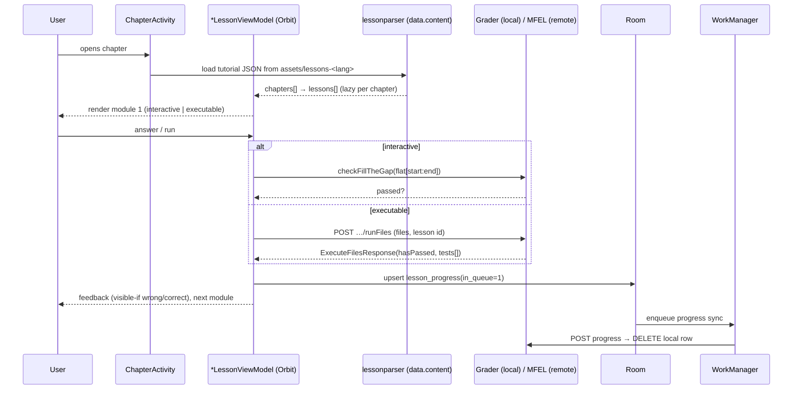

# 18 — Complete system architecture

## 1. Layering (as evidenced by packages and libraries)

```
┌──────────────────────────────────────────────────────────────────────────┐
│ PRESENTATION  1,869 classes under com.getmimo.ui.*                       │
│   61 Activities · 22 Fragments · 87 BottomSheets · 44 Dialogs            │
│   809 XML layouts + Jetpack Compose (AI tutor sheet, coding keyboard)    │
│   MVI: Orbit (org.orbitmvi.*) for screens, Redux-Kotlin for app state    │
├──────────────────────────────────────────────────────────────────────────┤
│ DOMAIN        155 classes under com.getmimo.interactors.*                │
│   use-cases: progress writing, freemium quota, practice, keys, streak    │
├──────────────────────────────────────────────────────────────────────────┤
│ DATA          606 classes under com.getmimo.data.*                       │
│   content/ (packs, lessonparser) · source/local (Room, prefs, repos)     │
│   source/remote (Retrofit APIs, 71 endpoints) · model/* (DTOs)           │
├──────────────────────────────────────────────────────────────────────────┤
│ CORE          22 classes: core.model.{streak,coins,keys,lesson,…}         │
│               apputil/ (30), network/ (6), util/ (3), analytics/ (334)   │
├──────────────────────────────────────────────────────────────────────────┤
│ PLATFORM      WorkManager · Firebase (Auth/Messaging/RC/InApp) ·         │
│               RevenueCat · Adjust · Customer.io · Glance · Rive ·        │
│               OkHttp/Retrofit · kotlinx.serialization · Room             │
└──────────────────────────────────────────────────────────────────────────┘
```
Class counts are from `tools/dex_evidence.py` + `data/all-classes.txt`; library presence from
class namespaces. The architecture is a textbook **clean-ish architecture with MVI at the edge**,
except that the *content* layer is an in-memory parser over immutable assets rather than a
repository over a database — the single most consequential deviation from the pattern.

## 2. Three stateful subsystems

| Subsystem | State | Store | Sync |
|---|---|---|---|
| Learning | lesson/chapter/tutorial progress | Room (3 tables) | outbox → `/v1/tutorials/{id}/progress` |
| Economy | spark/coin/key/streak/league | server + in-memory | request/response, no cache table |
| Content | 10 packs, versioned | assets (immutable) | none (ships in APK) |

This tri-partition explains almost every behaviour in this report: the app can learn offline
because content is local and progress is queued; it cannot socialise offline because the economy
is remote; and it cannot update content without an app release.

## 3. Runtime sequence — a single lesson (verified literals, inferred order)



## 4. Deployment topology (I, from hosts + endpoints)

```
Android client ──TLS──► api.mimo.org (v1 REST + SSE + Pusher auth)
     │                   ├─ content/curriculum service (tracks, progress, eta, certificates)
     │                   ├─ execution service ("MFEL") ──► sandboxed runners (web/py/node/sql/swift)
     │                   ├─ economy service (keys, coins, rewards, leaderboards, streak)
     │                   ├─ aiTutor service ──► LLM provider (UNKNOWN)
     │                   ├─ config service (/v2/client-config)
     │                   └─ analytics collector (/v1/events)
     ├──► api-testing.mimo.org (same surface, non-prod)
     ├──► Firebase (auth, config, messaging, A/B, in-app messaging)
     ├──► RevenueCat ──► Google Play / Amazon Appstore
     ├──► Adjust (attribution)  ├──► Customer.io (lifecycle)  ├──► Mixpanel (product analytics)
     └──► Pusher (live content + authoring updates)
```
The testing host pair, the execution service and Pusher are the three items a Konkur equivalent
must reproduce differently (self-hosted, no sandbox runners, no third-party push).

## 5. Diagrams

The 16 required diagrams are in `diagrams/` as editable Mermaid (`.mmd`) and Graphviz (`.dot`)
sources:
1. `01_system_context` · 2. `02_component_inventory` · 3. `03_navigation_graph` ·
4. `04_onboarding_state_machine` · 5. `05_lesson_player_sequence` ·
6. `06_interactive_grading_flow` · 7. `07_executable_grading_sequence` ·
8. `08_curriculum_data_model` · 9. `09_lesson_dsl_grammar` · 10. `10_content_pipeline` ·
11. `11_economy_map` · 12. `12_progress_sync_state` · 13. `13_remote_config_precedence` ·
14. `14_ai_tutor_context` · 15. `15_module_dependencies` · 16. `16_konkur_target_architecture`.

## 6. Architectural verdict

| Trait | Assessment |
|---|---|
| Content/engine separation | **Excellent** — a 3-value visibility enum and derived answers carry a 18k-lesson corpus |
| State partitioning | **Good** — three subsystems with clear authority; no distributed-state bugs by construction |
| UI architecture | **Mixed** — MVI per screen but 61 activities + 87 sheets; modal-first flow saved it |
| Network layer | **Adequate** — 71 endpoints, v1/v2 drift, dual hosts, no pagination strategy visible |
| Testability | **Unknown** — fixtures (`assets/testdata/45-1-1.html`, `test-tutorial.json`, `mock/tracks.json`) ship in release, suggesting golden-file testing of the parser |
| Operability | **High** — dev menu + live deploy + flag overrides + fake states |
| Security posture | **Weak-but-typical** — dev tools, plaintext tokens, no attestation, WebView bridge |
