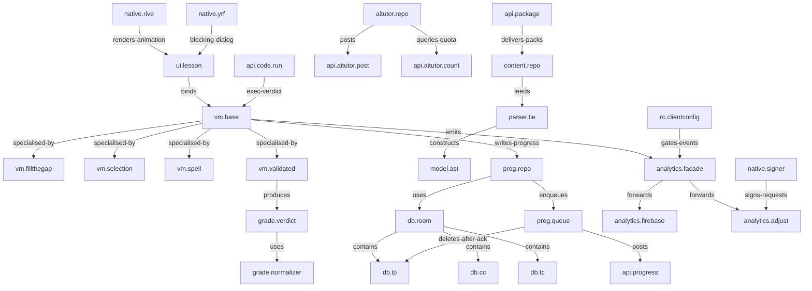
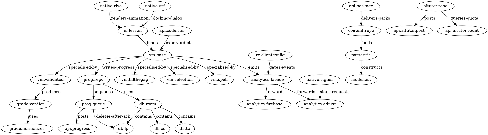

# Mission 5 — Unified System Graph

## Scope
One dependency graph spanning UI, view models, grading, parser, repositories, persistence,
network, analytics, native and remote config — as an editable artifact (JSON + Mermaid + DOT).

## Sources
`evidence/API_CATALOG_V2.csv`, `evidence/DTO_CATALOG.csv`, and the class/method reads cited in the
per-domain documents of this mission.

## Method
Nodes were admitted only if a class/method/endpoint was read this mission; edges carry their own
evidence label inside `system_graph.json`. Inference-only edges are kept and marked, never merged
into verified ones.

## Findings
- 34 nodes, 28 edges.
- Verified edges: 22 of 28.
- The lesson engine is a *fan-in* structure: four per-type view models converge on one base class,
  and the base class is the only writer of progress and the only emitter of lesson analytics.
- The parser (`te/*`) sits entirely outside `com.getmimo` — the single most consequential structural
  fact of this mission, because it is why the first decompilation pass missed it.

## Mermaid

## DOT

## Evidence labels
Node existence: **VERIFIED_STATIC** unless the node id ends in a documented inference. Edge labels are
per-edge in the JSON.

## Limitations
This is a *lesson-and-progress* centred graph; auth, subscription purchase flow and the full UI
navigation graph are not included (see `22_FINAL_AUDIT/` for their status).

## Reproduction
`python3 -c "import json;d=json.load(open('18_SYSTEM_GRAPH/system_graph.json'));print(len(d['nodes']),len(d['edges']))"`

## Unresolved
`U-26` the graph omits auth, purchase flow and navigation; edges marked INFERRED were not promoted.
