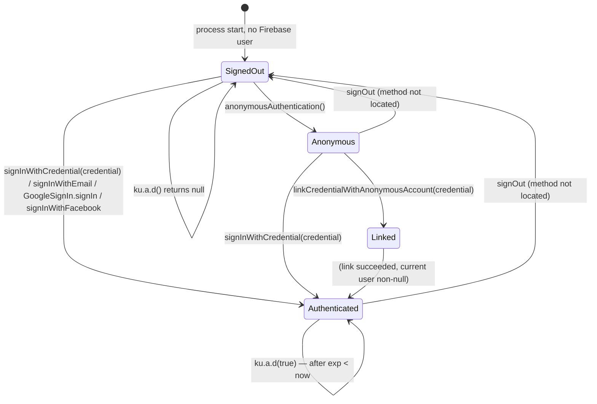

# Phase 5.4 — Session state machine

A state machine is only written where a transition is evidenced by code that can switch state. Where the evidence
stops, the machine stops.

## Evidenced states

| State | Definition in code |
|---|---|
| `SignedOut` | `FirebaseAuth.currentUser == null` → `ku.a.d` logs `"There is no Firebase user!"` and returns `null` |
| `Anonymous` | a Firebase user exists but holds no linked credential — the repository exposes `anonymousAuthentication` and a separate `linkCredentialWithAnonymousAccount` |
| `Linked` | `linkCredentialWithAnonymousAccount` reported success; its guard string is `"Linking credential was successful but current user is null!"` |
| `Authenticated` | `signInWithCredential` / e-mail / Google / Facebook paths; guard string `"Login was success but current user is null!"` |

## Evidenced transitions

| Transition | Code |
|---|---|
| `SignedOut → Anonymous` | `anonymousAuthentication` family (mapping MEDIUM, see 5.3) |
| `Anonymous → Linked/Authenticated` | `a.i(AuthCredential, …)`, 181 instructions, `linkCredentialWithAnonymousAccount` (HIGH) |
| `SignedOut → Authenticated` | `a.l(AuthCredential, …)`, 117 instructions, `signInWithCredential` (HIGH) |
| `Authenticated → Authenticated` (token refresh) | `ku.a.d(Z)` L6–L9 |
| any → `SignedOut` (session invalidation by SDK) | observed indirectly: `AuthenticationFirebaseRepository$init$1` collects a flow built from `ua0.h.g(<field>.b)` filtered, i.e. the repository **observes** auth-state changes rather than owning them |

## Not evidenced (and therefore not drawn)

* **Sign-out**: no `signOut()` call site was located in the app namespace during this phase. The UI package
  `com.getmimo.ui.authentication.logout.{a,b}` exists, but its methods were not read. Recorded as
  `PARTIALLY_CLOSED`, not as "sign-out does not exist".
* **Token revocation**: `ku.a.d` schedules a `Runnable` through `zu.b` (Firebase app + executor) that is consistent
  with `FirebaseUser.delete`/token invalidation bookkeeping, but the `Runnable` target (`app.rive.c`) is a shared
  helper whose body was not read; the transition is not claimed.
* **Session expiry by server**: nothing in the client can observe it directly; the only client-side expiry signal is
  the JWT `exp` claim.
* **Account deletion → session end**: `account.a.c()` schedules deletion, but whether the local Firebase user is
  cleared afterwards is not traced.

## Consequence for Phase 6 and 7

Because the repository *observes* auth state through a flow rather than owning a mutable session object, session
changes propagate to all collectors (`Flow.collect` × 246 in the graph). Any feature that behaves differently after
login is a **collector** of that flow, not a field read — which is why the learner/progress phases must look for
`collect` sites rather than for `currentUser` checks.

## Evidence

`evidence/DEX_authentication_repos.json`, `evidence/METHOD_NAME_RECOVERY.json`,
`/tmp/dad/com.getmimo.data.source.remote.authentication.AuthenticationFirebaseRepository$init$1.java` (32 lines,
read in full; referenced, not committed).
