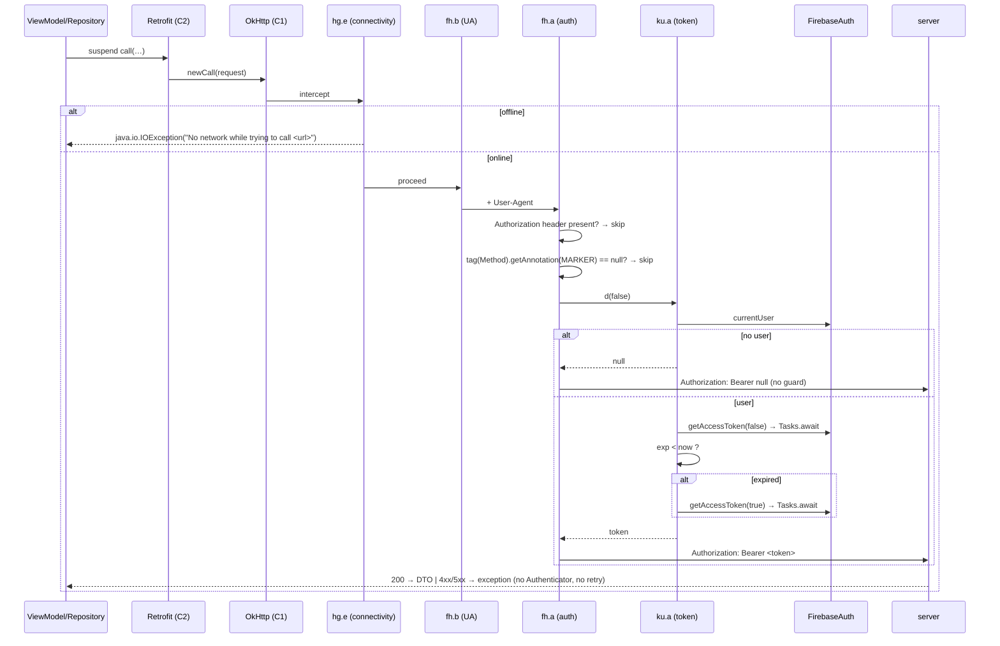

# Phase 3 — Authentication lifecycle

Revalidation of mission-08 phase 5 (Q-121) against the committed instruction dumps, plus what that phase could not
settle.

## 1. Six separate things, kept separate

| Concern | Owner in this app | Evidence |
|---|---|---|
| **identity** (who the user is) | FirebaseAuth (`FirebaseAuth.currentUser`) | `ku.a.d` body |
| **application authorization** (which API calls carry a token) | Retrofit **method annotation** → `fh.a` | `fh.a.intercept` |
| **API access token** | Firebase ID token, fetched per request | `ku.a.d(Z)` |
| **user profile data** | `GET /v1/users/{userId}/profile`, `GET /v1/user/settings` | catalogue |
| **local preferences** | `mimo_prefs*` (Stage 6) | Stage 6 |
| **server-side session** | not represented locally; the client holds no session id | negative finding |

Nothing in the client stores an "app token": the only token is the Firebase ID token, produced on demand. That is why
logout/expiry is not a client state machine but a FirebaseAuth state observation.

## 2. The token chain (VERIFIED_STATIC, phase 5 evidence re-read)

```text
fh.a.intercept(chain)
 ├─ if request.header("Authorization") != null        → skip (idempotent)
 ├─ tag = request.tag(KClass<ge0.s>)                  → Retrofit Method
 ├─ if tag.cast(...).getAnnotation(MARKER) == null     → skip (unauthorized endpoint)
 └─ token = ku.a.d(false)                              → "Bearer " + token
      ku.a.d(force):
        if (FirebaseAuth.currentUser == null)          → log "There is no Firebase user!", return null
        r = Tasks.await(getAccessToken(force))          // blocking, OkHttp thread
        exp = r.claims["exp"]; if (now < exp) return r.token
        return Tasks.await(getAccessToken(true)).token  // one forced refresh
        on failure → AccessTokenUnavailableException
```

Three properties worth naming because they cause real behaviour:

1. **`ku.a.d(false)` on every authorized request** — the SDK cache makes this cheap, but it is a *blocking*
   `Tasks.await` on the OkHttp thread, so an authorized request on a cold token performs two network round-trips to
   Google before the app's own request starts.
2. **`forceRefresh = false`** in the interceptor: expired tokens are refreshed *inside* `ku.a.d`, not by the caller.
3. **`null` token is not guarded at the concat site** — `"Bearer " + null` yields `Authorization: Bearer null`, which
   the server rejects as malformed. The client does *not* distinguish "signed out" from "token refused".

## 3. Lifecycle diagram



## 4. Session states (from phase 5, unchanged)

`SignedOut` (no Firebase user) → `Anonymous` (`anonymousAuthentication`) → `Linked`/`Authenticated`
(`linkCredentialWithAnonymousAccount`, `signInWithCredential`, e-mail, Google, Facebook). The repository **observes**
auth state through a flow rather than owning a mutable session object, so downstream features react to the flow, not
to a `currentUser` field.

**Sign-out** remains `PARTIALLY_CLOSED`: the `ui.authentication.logout.{a,b}` package exists but its body was not
recovered in any mission, so a `signOut()` call is neither proven nor refuted.

## 5. What Stage 7 adds to phase 5

| Addition | Evidence |
|---|---|
| the interceptor's **order** in the chain (connectivity → UA → auth) is proven, so an offline request fails **before** any token fetch | DI case 20 `add(…)` sequence |
| the token provider is a **single component method** (`b()`) consumed by four different transports (C1's interceptor, C3, C7, C8) | DI cases 20/108/81/113 |
| four transports authenticate differently: header via interceptor (C1/C3), manual header (C7), subprotocol (C8) | cases 81/113 + phase-5 dumps |
| the annotation mechanism is a **`Method` tag**, i.e. per-endpoint and resolved at call time | `fh.a.intercept` dump |

## 6. Residual unknowns

* the marker annotation's exact type (`ri.b` by elimination within `ri.*`, **INFERRED_HIGH**);
* per-endpoint annotation presence (`BLOCKED_BY_ENVIRONMENT`, A-01);
* whether a 401 ever triggers re-authentication (no `Authenticator`, no retry, no interceptor branch → **no**, and the
  UI consequence is not traced);
* sign-out path (A-02).
