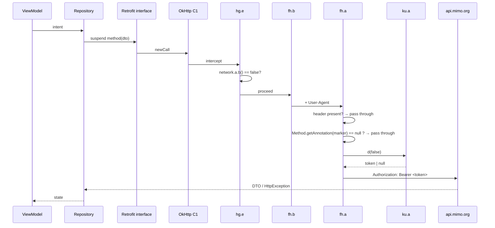
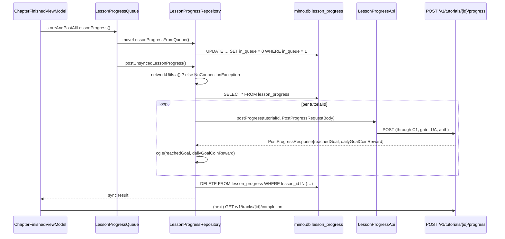
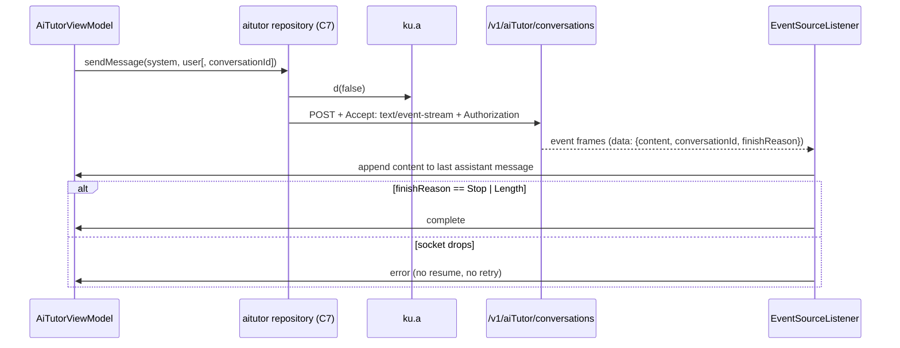
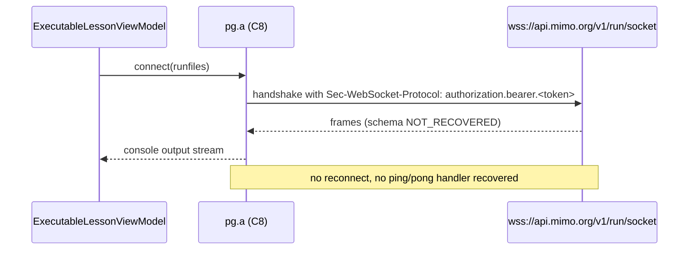
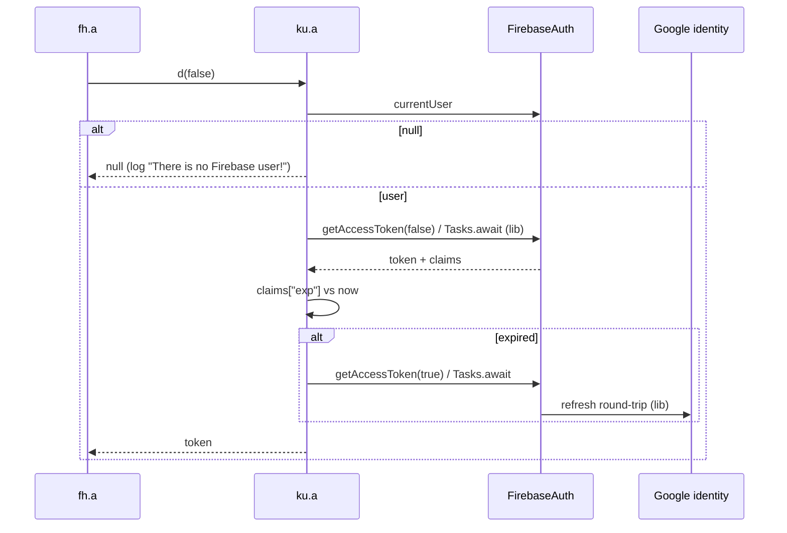

# Phase 10 — Sequence diagrams

All participants are recovered classes. Steps that are library behaviour are marked *(lib)*.

## 10.1 Authenticated REST call

## 10.2 Progress flush (Stage 5 outbox over Stage 7 transport)

## 10.3 AI tutor SSE

## 10.4 Code execution over the socket

## 10.5 Token acquisition (inside `ku.a.d`)

