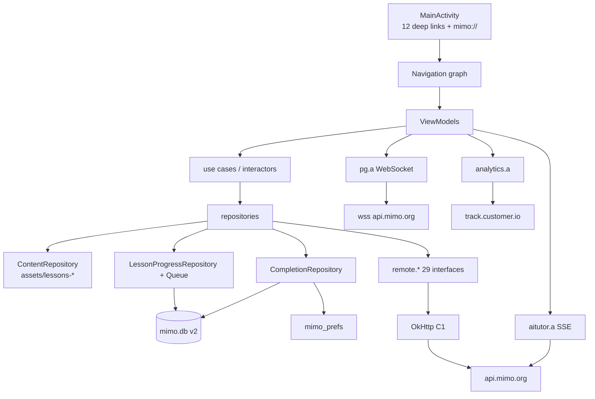
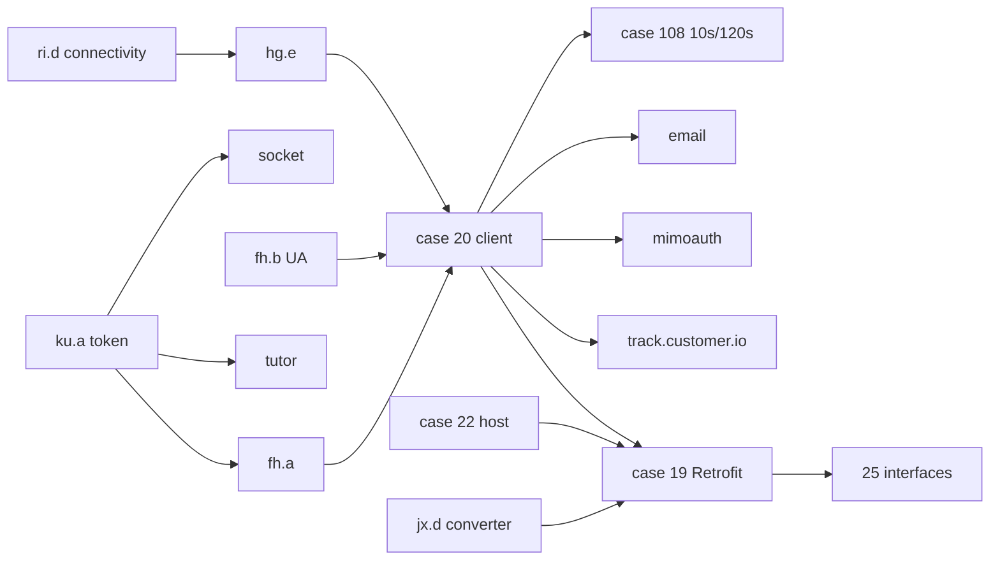
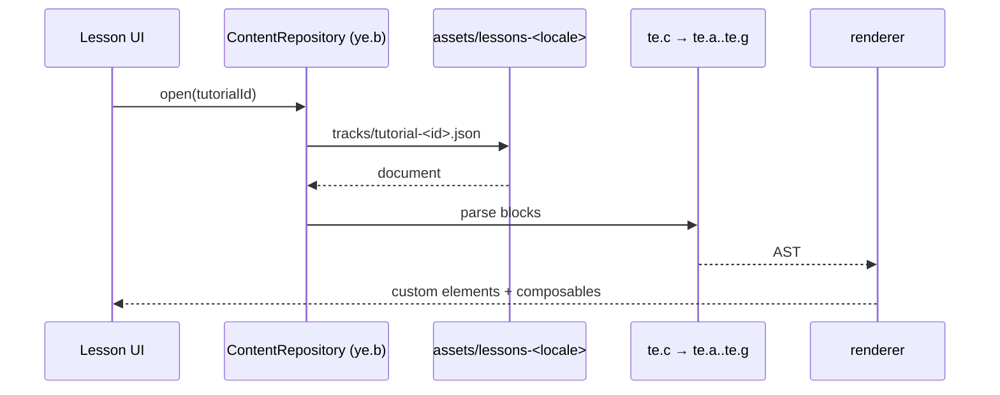
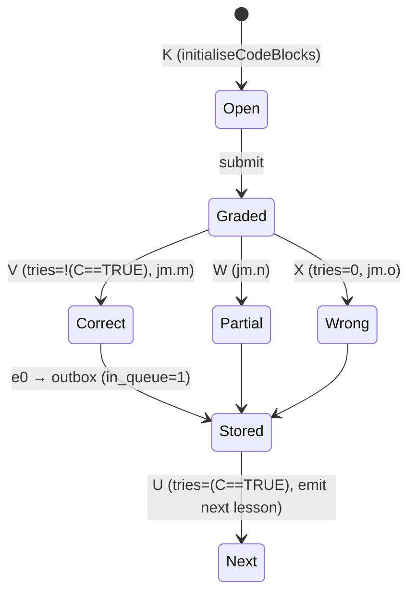
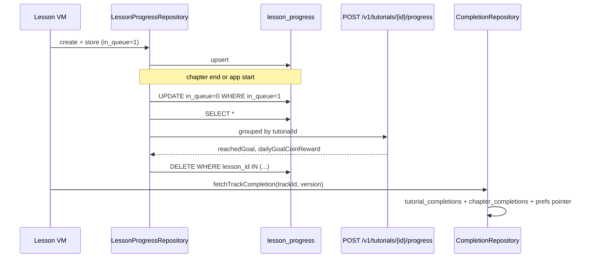
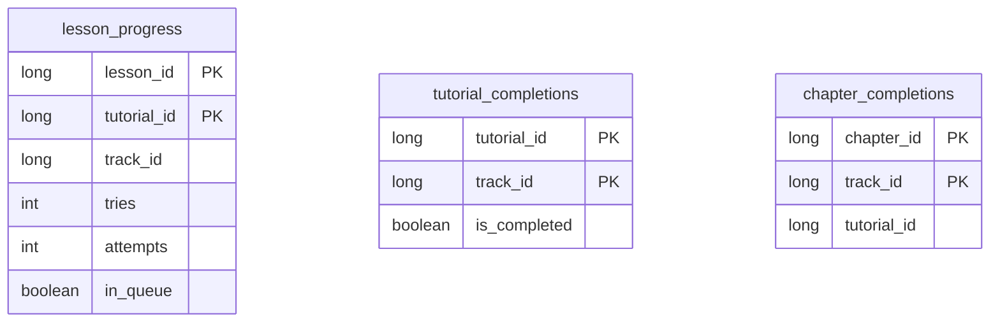
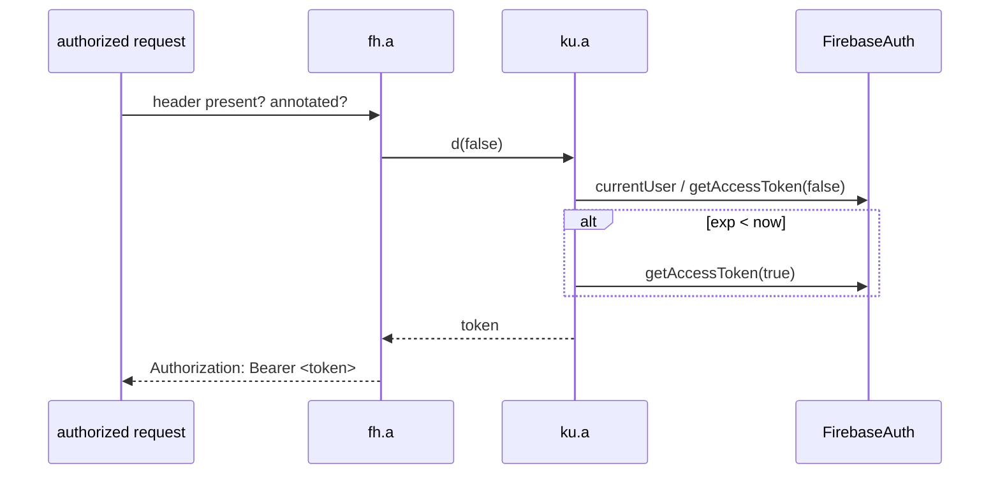
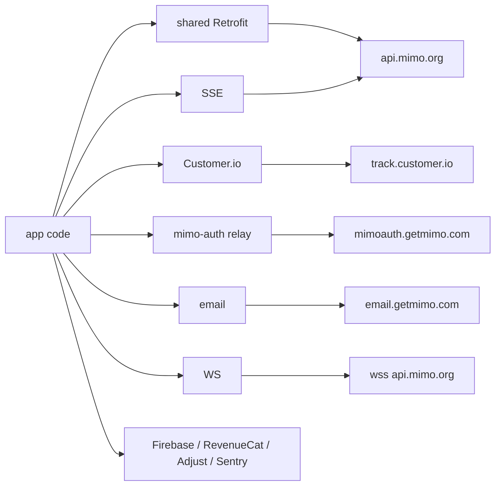
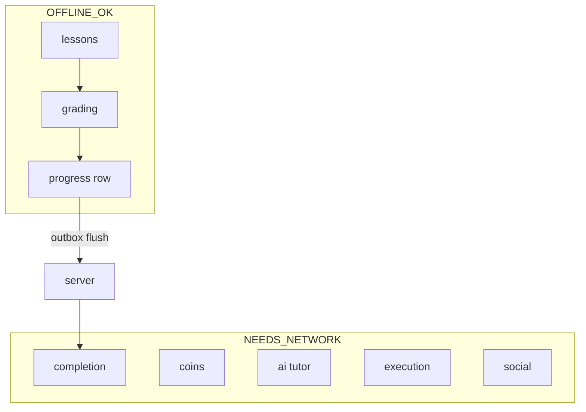

# 19 — Final architecture diagrams

All diagrams are derived from recovered evidence; no box exists that is not backed by a record in `16`.

## 1. Application architecture

## 2. Dependency injection (network arm)

## 3. Content delivery

## 4. Lesson + grading + feedback

## 5. Learner progress lifecycle

## 6. Database schema

## 7. Authentication lifecycle

## 8. Network topology

## 9. Offline boundary

## 10. Domain map

45 domains, statuses in `15_FINAL_COVERAGE_MATRIX.csv`: 25 COMPLETE, 15 SUBSTANTIALLY, 5 PARTIALLY, 0 unclassified.
