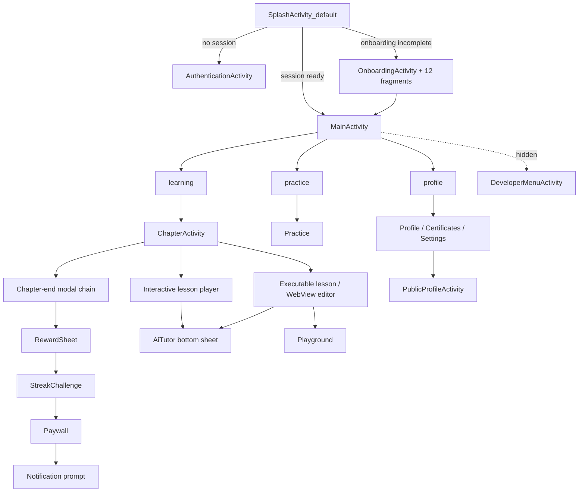

# ۰۶ — ناوبری، deep linkها و جریانها

## ۱. قواعد اندازهگیری شده

| قاعده | شاهد | اطمینان |
|---|---|---|
| تنها یک گراف ناوبری اعلانی (آنبوردینگ) | `res/navigation/nav_onboarding_graph.xml` | HIGH |
| بقیهٔ ناوبری imperative است (Intent/Fragment) | ۶۱ activity در مقابل ۱ graph | HIGH |
| راهانداز یک `activity-alias` است | `SplashActivity_default` | HIGH |
| ۶ alias برای تغییر آیکون | `_default/_ninja/_ukraine/_chemist/_bat/_proud` | HIGH |
| ۱۰۹ کلاس مستقیماً `R.layout.*` را inflate میکنند | `SOURCE/dex/LAYOUT_XREFS.csv` | HIGH |
| تبها قابل پنهانشدن/بجدار شدناند | `NavigationBar$listenToTabVisibilityChanges` (دور قبل) | MEDIUM |
| پایان فصل زنجیرهٔ modal است نه صفحه | `ModalData$*`, `reward_drag_to_dismiss` | MEDIUM |

## ۲. همهٔ ۴۶ عنصر `<data>` مانیفست (فهرست کامل)

| # | ویژگیها |
|---|---|
| 1 | mimeType=*/* |
| 2 | scheme=https |
| 3 | mimeType=vnd.android.cursor.dir/event |
| 4 | scheme=sms |
| 5 | path=tel: |
| 6 | host=getmimo.com, path=/login, scheme=https |
| 7 | host=getmimo.com, path=/register, scheme=https |
| 8 | host=getmimo.com, path=/onboarding/experience, scheme=https |
| 9 | host=getmimo.com, path=/onboarding/goal, scheme=https |
| 10 | host=getmimo.com, path=/resetpassword, scheme=https |
| 11 | host=getmimo.com, path=/login, scheme=mimo |
| 12 | host=getmimo.com, path=/register, scheme=mimo |
| 13 | host=getmimo.com, path=/onboarding/experience, scheme=mimo |
| 14 | host=getmimo.com, path=/onboarding/goal, scheme=mimo |
| 15 | host=getmimo.com, path=/resetpassword, scheme=mimo |
| 16 | host=getmimo.com, path=/deeplink/continuelearning, scheme=mimo |
| 17 | host=getmimo.com, path=/deeplink/support, scheme=mimo |
| 18 | host=getmimo.com, path=/deeplink/practiceshortcut, scheme=mimo |
| 19 | scheme=@string/fb_login_protocol_scheme |
| 20 | host=cct.com.getmimo, scheme=fbconnect |
| 21 | host=getmimo.com, path=/profile, scheme=https |
| 22 | host=getmimo.com, pathPattern=/learn/.*, scheme=https |
| 23 | host=getmimo.com, path=/learn, scheme=https |
| 24 | host=getmimo.com, pathPattern=/explore/.*, scheme=https |
| 25 | host=getmimo.com, path=/deeplink/practicetab, scheme=https |
| 26 | host=getmimo.com, pathPattern=/leaderboard/.*, scheme=https |
| 27 | host=getmimo.com, pathPattern=/invite/.*, scheme=https |
| 28 | host=getmimo.com, path=/leaderboard, scheme=https |
| 29 | host=getmimo.com, pathPattern=/allplans, scheme=https |
| 30 | host=getmimo.com, pathPattern=/upgradeapp, scheme=https |
| 31 | host=getmimo.com, path=/deeplink/upgradepaywall, scheme=https |
| 32 | host=getmimo.com, pathPattern=/deeplink/upgradepaywall/.*, scheme=https |
| 33 | host=getmimo.com, path=/profile, scheme=mimo |
| 34 | host=getmimo.com, pathPattern=/learn/.*, scheme=mimo |
| 35 | host=getmimo.com, path=/learn, scheme=mimo |
| 36 | host=getmimo.com, pathPattern=/explore/.*, scheme=mimo |
| 37 | host=getmimo.com, path=/deeplink/practicetab, scheme=mimo |
| 38 | host=getmimo.com, pathPattern=/leaderboard/.*, scheme=mimo |
| 39 | host=getmimo.com, pathPattern=/invite/.*, scheme=mimo |
| 40 | host=getmimo.com, path=/leaderboard, scheme=mimo |
| 41 | host=getmimo.com, pathPattern=/allplans, scheme=mimo |
| 42 | host=getmimo.com, pathPattern=/upgradeapp, scheme=mimo |
| 43 | host=getmimo.com, path=/deeplink/upgradepaywall, scheme=mimo |
| 44 | host=getmimo.com, pathPattern=/deeplink/upgradepaywall/.*, scheme=mimo |
| 45 | host=firebase.auth, path=/, scheme=genericidp |
| 46 | host=firebase.auth, path=/, scheme=recaptcha |

الگوهای پذیرفتهشده: `https://getmimo.com/login`, `/register`, `/resetpassword`,
`/onboarding/experience`, `/onboarding/goal`, `/learn/.*` به علاوهٔ اسکیمای `mimo://`.

## ۳. نقشهٔ جریان

## ۴. ناوبری استخراجشده از بایتکد (همهٔ ۱۰۹ نگاشت)

`SOURCE/dex/LAYOUT_XREFS.csv` حاصل خواندن operandهای `const` در متدهاست؛
یعنی «این کلاس، این لایه را inflate میکند» یک مشاهدهٔ مستقیم است، نه حدس نام.
`RECONSTRUCTION/kotlin/` بر اساس همین نگاشتها ۱۰۹ اسکلت کاتلین ساخته است.

## ۵. منوها (۵ فایل، کامل)

`bottom_navigation_menu.xml`, `crop_image_menu.xml`, `menu_profile.xml`,
`menu_public_profile.xml`, `menu_settings.xml` → `SOURCE/res/menu/`.

## ۶. آنچه نیاز به اجرا دارد (`NOT_TESTED`)

* رفتار Back در میانهٔ زنجیرهٔ مودال.
* ترتیب واقعی تبها و برچسبها (آیکوناند یا از سرور میآیند) — `UNKNOWN`.
* بازگشت از deep link به درس نیمهتمام (بازسازی context از Room).
* انتخاب پیکربندی `layout-v31`/`layout-v33` روی دستگاه واقعی (در استاتیک فقط وجود فایلها ثابت است).
