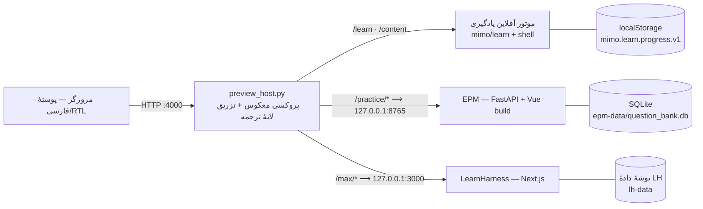

# معماری یکپارچه‌سازی پیش‌نمایش میمو

## ۱. شکل کلی

سه موتور مستقل‌اند: هر کدام فرایند، حافظهٔ داده و چرخهٔ عمر خودش را دارد. **هیچ پل داده‌ای، هیچ پایگاه‌دادهٔ مشترک و
هیچ خواندن متقابل پیشرفت وجود ندارد.** پوسته فقط یک ناوبری و یک لایهٔ زبان است.

## ۲. تصمیم‌های کلیدی و دلیلشان

| تصمیم | دلیل | جایگزینی که رد شد |
|---|---|---|
| یک مبدأ، یک پورت (`:4000`) با پروکسی معکوس | iframe هم‌مبدأ می‌شود؛ کوکی/سرویس‌ورکر/مسیرها بدون مشکل CORS کار می‌کنند | سه پورت جدا + iframe بین‌مبدأ: `X-Frame-Options` و CORS و کوکی‌ها همه شکننده می‌شدند |
| EPM با پیشوند `/practice` و **حذف** پیشوند در پروکسی | EPM انتظار ریشهٔ `/api` دارد؛ با حذف پیشوند هیچ فایلی در بک‌اند تغییر نکرد | افزودن پیشوند در بک‌اند EPM = تغییر منطق موتور |
| LearnHarness با `basePath: "/max"` و **حفظ** پیشوند | Next.js دارایی‌های ثابت و RSC را با پیشوند می‌سازد؛ حذف پیشوند آن‌ها را می‌شکند | بازنویسی مسیرها در پروکسی = ۴۰۴ روی `_next` |
| پوسته + موتور یادگیری کاملاً درون‌میزبان | بخش «یادگیری» باید بدون شبکه و بدون سرور جانبی کار کند | iframe برای Learn: بی‌دلیل پیچیده |
| حذف `X-Frame-Options` و CSP فقط برای پاسخ‌های همان‌میزبان | لازمهٔ نمایش درون iframe پوسته | تغییر کد موتورها |
| لایهٔ ترجمه در زمان اجرا (`fa.js`) | موتورها دست‌نخورده می‌مانند و ارتقای آن‌ها ترجمه را نمی‌شکند | فورک کردن فرانت‌اند EPM/LH |
| `EPM_AUTH=0` و فقط ۱۲۷.۰.۰.۱ | پیش‌نمایش محلی؛ هیچ حساب/رمز واقعی | احراز هویت ساختگی |

## ۳. مسیرهای پروکسی

| مسیر | مقصد | رفتار |
|---|---|---|
| `/` | پوسته (فایل‌های ایستا) | — |
| `/learn/*`, `/content/*` | موتور یادگیری | — |
| `/practice/*` | `http://127.0.0.1:8765/*` | پیشوند حذف می‌شود |
| `/max`, `/max/*` | `http://127.0.0.1:3000/max`, `…/max/*` | پیشوند حفظ می‌شود (بدون ریدایرکت: Next مسیر `/max/` را canonical می‌کند) |
| `/__overlay/fa.js`, `/__overlay/dict-*.json` | فایل‌های `host/overlay/` | به HTML تزریق می‌شود |
| `/api/preview/status` | وضعیت سه موتور | JSON برای صفحهٔ عیب‌یابی |
| `POST /api/preview/i18n-missing` | `docs/i18n-missing.json` | گزارش رشته‌های ترجمه‌نشده از مرورگر |

اگر موتوری بالا نباشد، پروکسی **۵۰۲** با پیام فارسی و توضیح «چگونه راه‌اندازی کنم» می‌دهد؛ پوسته هرگز صفحهٔ سفید نمی‌دهد.

## ۴. جدایی داده — اثبات عملی

| موتور | محل داده | چه چیزی ذخیره می‌شود |
|---|---|---|
| یادگیری (Mimo Learn) | `localStorage` کلید `mimo.learn.progress.v1` | وضعیت درس/فصل برای کاربر `local` |
| تمرین و آزمون (EPM) | `mimo/.runtime/epm-data/question_bank.db` | پروفایل بانک، جزوه، واحد، سؤال، گزینه، آزمون، پاسخ‌ها، دفتر اشتباهات |
| مکس (LearnHarness) | `mimo/.runtime/lh-data/` | دادهٔ خود LH با اسکیمای خودش |

هیچ‌کدام دیگری را نمی‌خواند و هیچ فرایندی هر سه را هم‌زمان نمی‌بیند. `EPM_DATA_DIR`/`LH_DATA_DIR` بیرون از مخزن
موتورها هستند تا `git pull` موتور داده را بازنویسی نکند.

## ۵. اعتبارسنجی جاسازی (پیش از ساخت)

| بررسی | نتیجه | شاهد |
|---|---|---|
| EPM در iframe | مجاز شد | `X-Frame-Options`/CSP حذف شد؛ سرویس‌ورکر EPM در iframe لغو ثبت می‌شود |
| LearnHarness در iframe | مجاز | همان میزبان؛ `basePath` باعث یکپارچگی دارایی‌ها شد |
| کوکی‌ها | لازم نیست | `EPM_AUTH=0`، LH با `LH_AUTH_FILE` محلی |
| مسیرهای API | درست | `/practice/api/health` = 200، `/practice/api/papers` = 200، `/max` = 200 |
| ناوبری درون/برون | کار می‌کند | زبانه‌ها via iframe؛ دکمهٔ «باز کردن در زبانهٔ تازه» به‌عنوان راه فرار |

## ۶. اگر iframe شکننده شد — راه فرار آماده

هر زبانهٔ موتور، دکمهٔ «باز کردن در پنجرهٔ جدا» دارد که همان مسیر (`/practice/…`, `/max`) را در زبانهٔ تازه باز می‌کند؛
بنابراین حتی اگر موتوری هدرهای جاسازی را برگرداند، مسیر کاربر قطع نمی‌شود و نوار زبانه‌های پوسته هم باقی می‌ماند.
