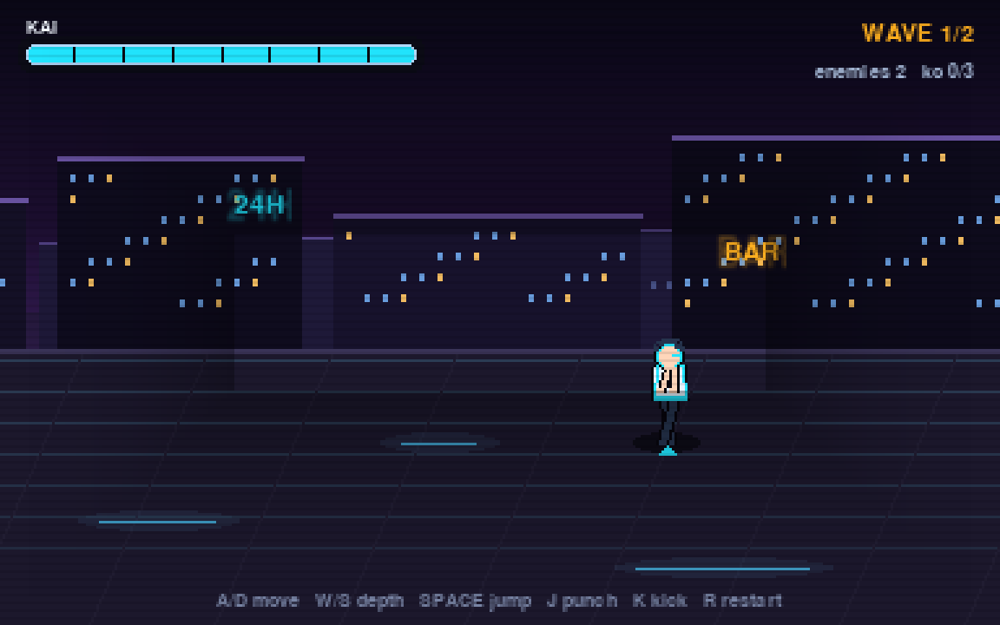

# Neon Alley — a small playable prototype on top of the reconstructed engine

**This is a new, original game.** It is not *Streets of Rage*, it is not a remake, a port
or a level from the original game, and it contains no original-game art, audio or data.
What it does reuse is the *verified behaviour* recovered in Stage 2: every frame it moves,
collides and draws through the modules in `components/sor_engine/`.

- 1 playable character (Kai), 1 neon night street, 3 enemies in 2 waves.
- 60 Hz fixed-step simulation, deterministic: no random numbers anywhere.
- ~1,540 lines of game code, ~830 lines of tests, one dependency (pygame).



---

## 1. Install

Python 3.9+ (developed and tested on 3.11.2). One dependency: `pygame`.

```bash
cd <this repository>
python3 -m venv .venv
.venv/bin/pip install pygame          # tested with pygame 2.6.1 / SDL 2.28.4
```

Nothing else is needed. No network access is required after the install, no server, no
build step, no asset download: all art is generated procedurally at start-up.

> If you already have a working `.venv` at the repository root from Stage 2 work, reuse it
> — the prototype needs only `pygame`.

## 2. Launch

From the repository root:

```bash
.venv/bin/python -m prototype.neon_alley
```

Alternative form (identical behaviour):

```bash
.venv/bin/python prototype/neon_alley/main.py
```

Options:

| flag | effect |
| --- | --- |
| `--windowed 1600x900` | initial window size (default `1280x720`) |
| `--fullscreen` | start fullscreen (`Esc` quits, `F11` toggles) |
| `--autopilot` | let the deterministic demo pilot play for you |
| `--frames N` | stop after N frames (used by the headless smoke test) |
| `--shot FILE.png` | save the first rendered frame to a PNG |

Headless (no display, e.g. on a server or in CI):

```bash
SDL_VIDEODRIVER=dummy SDL_AUDIODRIVER=dummy .venv/bin/python -m prototype.neon_alley --frames 120
```

## 3. Controls

| key | action |
| --- | --- |
| `A` / `D` | walk left / right (facing follows the direction) |
| `W` / `S` | step up / down through the depth lanes (into / out of the screen) |
| `SPACE` | jump — hold `A` or `D` while airborne for air control |
| `J` | punch — fast, 7 damage, 13-frame commitment |
| `K` | kick — slower, 13 damage, 29-frame commitment, longer recovery |
| `R` | restart from the first wave at any time |
| `ENTER` | start the game from the title screen |
| `ESC` | quit |
| `F11` | toggle fullscreen |

The same list is printed on the title screen and again along the bottom of the HUD, so it
is visible while playing.

## 4. How to read the screen

- **Top left** — Kai's health bar. **Top right** — wave number and knockouts.
- **Bottom** — control strip.
- Your character has a cyan ground marker under the feet; the marker stays on the ground
  when you jump, so you can always tell which lane you are in.
- Enemies glow in their own colour: amber and violet thugs, a lime brute.
- A spark burst, an expanding ring and a floating damage number appear on every clean hit,
  and the screen shakes briefly. A punch and a kick look and feel different on purpose.

## 5. Tests

```bash
# prototype integration suite (52 tests, writes prototype/TEST_REPORT.md)
SDL_VIDEODRIVER=dummy .venv/bin/python -m prototype.tools.run_tests

# the original Stage-2 verification, unchanged (needs the reverse-engineering venv)
/tmp/re_venv/bin/python tools/verify_stage2.py

# deterministic scripted encounter: record, replay, compare
SDL_VIDEODRIVER=dummy .venv/bin/python -m prototype.tools.record_encounter

# how often each verified component is called
SDL_VIDEODRIVER=dummy .venv/bin/python -m prototype.tools.measure_components

# regenerate the screenshots in screenshots/
SDL_VIDEODRIVER=dummy .venv/bin/python -m prototype.tools.capture_screens
```

Results are in [`TEST_REPORT.md`](TEST_REPORT.md) (machine-generated, real command output).

## 6. Where to read next

| file | contents |
| --- | --- |
| [`ARCHITECTURE.md`](ARCHITECTURE.md) | every reused component, its ROM routine, and the exact call path from the game loop |
| [`RULES.md`](RULES.md) | every rule the prototype adds itself, separated from the recovered ones |
| [`COMPLETION_REPORT.md`](COMPLETION_REPORT.md) | acceptance criteria 1–13 with PASS/FAIL evidence, numbers and limitations |
| [`TEST_REPORT.md`](TEST_REPORT.md) | the generated test report |
| `neon_alley/config.py` | constants tagged `[ROM]`, `[INTEG]`, `[PROTO]` |

## 7. Source map

```
prototype/
  neon_alley/
    main.py       window, event loop, key mapping, fixed-step accumulator, integer upscale
    game.py       Game: waves, combat resolution, collision, camera, effects, state machine
    entities.py   Fighter / Player / Enemy (each owns a components.sor_engine.Actor)
    adapter.py    the only module that imports components.sor_engine; counts every call
    config.py     tagged constants
    render.py     procedural art: skyline, street, fighters, effects, HUD, screens
    autopilot.py  deterministic demo/test pilot (emits Commands only)
  tests/          52 integration tests (unittest)
  tools/          run_tests, record_encounter, measure_components, capture_screens
  data/           recorded 875-frame input script
  screenshots/    visual evidence
```

## 8. Troubleshooting

- **`ModuleNotFoundError: No module named 'pygame'`** — you are using the system Python.
  Use `.venv/bin/python` exactly as shown above.
- **`pygame.error: No available video device`** — you are on a headless machine. Prefix the
  command with `SDL_VIDEODRIVER=dummy`.
- **No sound** — the prototype ships no audio files and never requires an audio device;
  `SDL_AUDIODRIVER=dummy` is safe.
- **Window opens and closes immediately** — check the terminal; `--frames` is a testing
  flag and exits by design.
